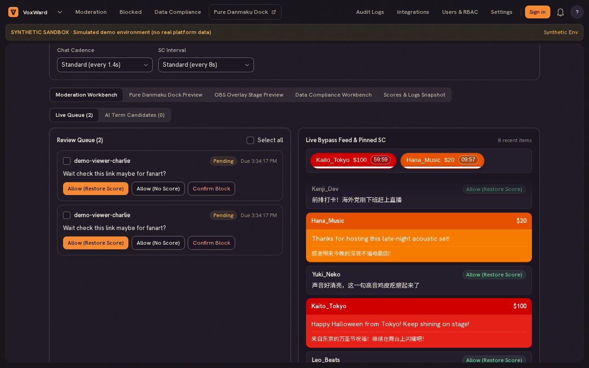
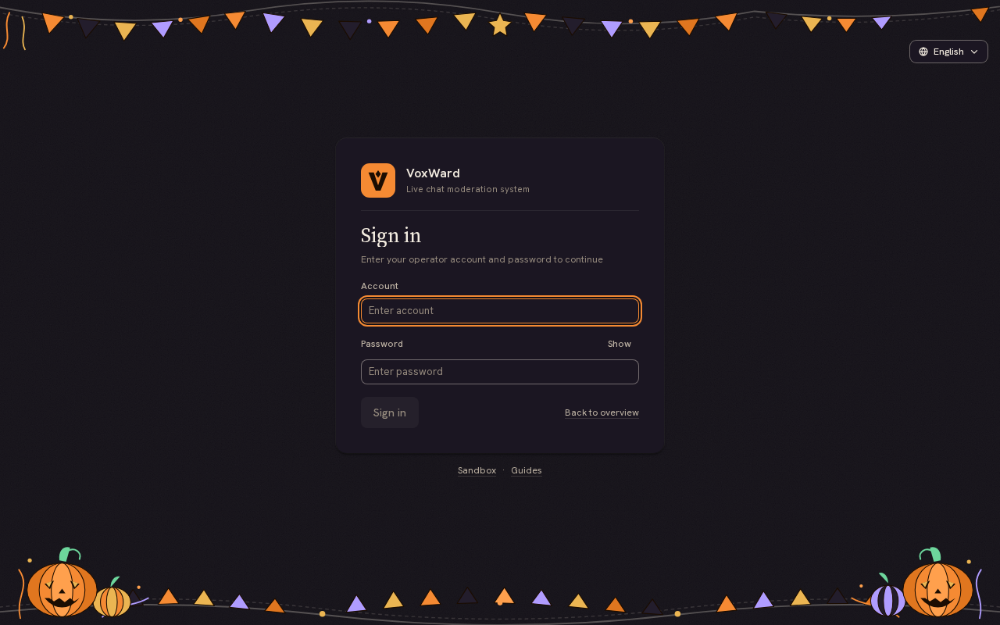
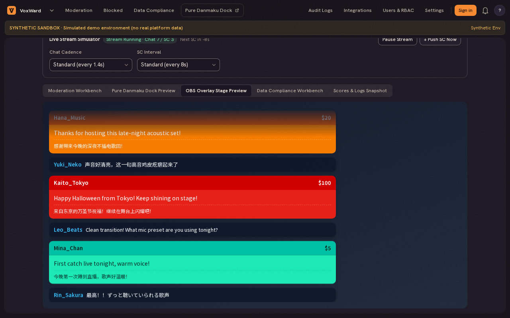
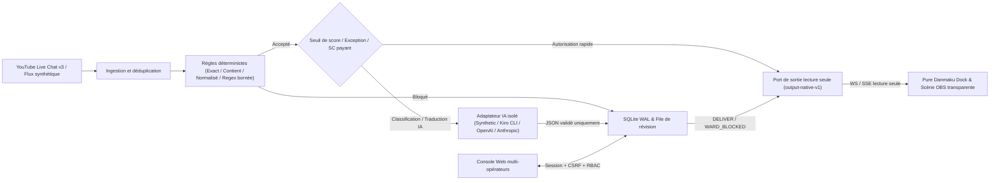

> Remarque : la [version anglaise](./README.md) fait foi · `synced-to: 03a4a0214d64a5fbb531715c2693872629852b977d7e29c2f9cd3ed1f8927438`

<div align="center">

<picture>
  <source media="(prefers-color-scheme: dark)" srcset="./docs/assets/voxward-icon-dark.svg">
  <source media="(prefers-color-scheme: light)" srcset="./docs/assets/voxward-icon.svg">
  
</picture>

# VoxWard

Intergiciel auto-hébergé de modération de chat et danmaku en direct, notation de confiance par chaîne et traduction de Super Chats pour les diffusions VTuber multilingues.

[English](./README.md) · [简体中文](./README.zh-CN.md) · [日本語](./README.ja.md) · [한국어](./README.ko.md) · **Français**

[](https://github.com/tpmoonchefryan/Voxward/releases/tag/rc0.1.0)
[](./LICENSE)
[](./docs/KIROWEEN.md)
[](https://github.com/tpmoonchefryan/Voxward/discussions)

[Aperçus](#aperçu-de-linterface) · [Démarrage Jury](#démarrage-rapide-jury-kiroween-2026) · [Architecture](#architecture-frankenstein) · [Auto-hébergement](#déploiement-auto-hébergé) · [Feuille de route](#feuille-de-route-vers-la-v10) · [Documentation](#index-de-la-documentation)

</div>

> [!NOTE]
> Développé par **tpmoonchefryan** sous licence **Apache-2.0** pour **Kiroween 2026 (Catégorie Frankenstein)**. L'interface démarre par défaut en **thème Halloween + anglais (`en`)** avec bascule dynamique en **5 langues** (`English`, `简体中文`, `日本語`, `한국어`, `Français`).

> [!IMPORTANT]
> **Avis de pré-version** : cette version (`rc0.1.0`) est une **pré-version** qui n'a **pas encore été testée en conditions réelles de diffusion en production**. Si vous êtes streamer ou équipe VTuber intéressé(e) par une utilisation réelle, contactez directement le mainteneur via [**GitHub Discussions**](https://github.com/tpmoonchefryan/Voxward/discussions) — les retours d'usage guideront la livraison d'une version validée en production.

---

## Pourquoi VoxWard

Les diffusions VTuber multilingues combinent un chat rapide et bruyant avec des messages payants (Super Chats) critiques. Les solutions courantes obligent à choisir entre de simples listes noires par mots-clés ou des bots CRM lourds.

VoxWard sépare proprement les responsabilités dans un intergiciel auto-hébergé :

- **Voie rapide déterministe** : correspondance exacte, sous-chaîne, normalisation, indices phonétiques multilingues et regex bornées combinés à un grand livre de score par chaîne en SQLite WAL.
- **Escalade IA isolée** : les messages ambigus et Super Chats sont envoyés à des tâches IA isolées avec identifiants temporaires (`item-*`) et validation JSON stricte — sans jamais exposer les jetons OAuth ni les identifiants utilisateurs stables aux prompts.
- **Sorties en lecture seule** : le dock épuré (`/dock/:channelId`) et la scène OBS transparente (`/overlay/:channelId#cred=vwo_...`) reçoivent uniquement des trames `ALLOW` / `WARD_BLOCKED`, sans scores internes ni contrôles de modération.

---

## Aperçu de l'interface



*Bureau de modération du bac à sable interactif en thème Halloween + anglais par défaut : simulateur de flux en direct, file d'attente scindée, barre de Super Chats épinglés avec compte à rebours et cartes bilingues.*

<table>
  <tr>
    <td width="50%" align="center">
      
      <br>
      <sub><b>Connexion par défaut (<code>/login</code>)</b> · Thème Halloween + sélecteur 5 langues</sub>
    </td>
    <td width="50%" align="center">
      
      <br>
      <sub><b>Scène OBS en lecture seule</b> · Flux danmaku multilingue &amp; Super Chats</sub>
    </td>
  </tr>
</table>

---

## Démarrage rapide Jury Kiroween 2026

- **Prérequis d'exécution** : `Node.js >= 24`, `pnpm 12.18` (aucune base de données externe requise — SQLite WAL embarqué).
- **Pile technique** : TypeScript, Fastify 5, React 19, Vite, Drizzle ORM + `better-sqlite3`, WebSocket (`ws`), `@tcrn/ui-react@4.2.0`, Docker & k3s (`local-path` + Traefik).

Aucune clé API YouTube ou LLM n'est requise. Le bac à sable synthétique échoue en sécurité (fail-closed) si des secrets de production sont présents dans l'environnement :

```bash
pnpm install --frozen-lockfile
pnpm build
node deploy/sandbox/start-sandbox.mjs
```

Ouvrez ensuite **`http://127.0.0.1:3100/sandbox`** dans votre navigateur :

1. Démarre en **Halloween + anglais (`en`)** ; le menu utilisateur en haut à droite permet de changer instantanément entre **5 langues** et **3 thèmes** (`halloween`, `light`, `dark`).
2. Observez le **Simulateur de flux en direct** injecter des messages danmaku et des cartes Super Chat avec compte à rebours (ou cliquez sur **`+ Push SC Now`**).
3. Testez les 6 scénarios prédéfinis et les 4 rôles de démonstration (**`Streamer View`, `Moderator View`, `Data Auditor`, `Stage Visitor`**) à travers le bureau de modération, le dock pur, la scène OBS, la conformité des données et les journaux.

Pour héberger une démo jury en ligne sur k3s, appliquez le recouvrement sans état [`deploy/k3s/sandbox/`](./deploy/k3s/sandbox/) (voir [`deploy/k3s/README.md`](./deploy/k3s/README.md)).

Voir le guide dédié : [Kiroween 2026 Submission Guide](./docs/KIROWEEN.md).

---

## Architecture Frankenstein



---

## Fonctionnalités principales

| Domaine | Points clés | Emplacements |
| --- | --- | --- |
| **Interface 5 langues & thèmes** | Thème `halloween` + `en` par défaut sur `/login`, `/sandbox` et nouveaux comptes ; persistance via `/auth/shell-preferences` | [`apps/web/src/i18n/`](./apps/web/src/i18n/), [`VoxWardShell.tsx`](./apps/web/src/shell/VoxWardShell.tsx) |
| **Modération en direct** | Vue scindée, verdicts groupés, promotion de mots-clés candidats, réévaluation du score | [`ModerationPage.tsx`](./apps/web/src/pages/moderation/ModerationPage.tsx) |
| **Dock pur & Overlay OBS** | Flux épuré (`/dock/:channelId`) et scène WebSocket OBS authentifiée uniquement par fragment `#cred=vwo_...` (`/overlay/:channelId`) | [`DockPage.tsx`](./apps/web/src/pages/dock/DockPage.tsx), [`Stage.tsx`](./apps/web/src/pages/overlay/Stage.tsx), [`output-native-v1.md`](./docs/protocol/output-native-v1.md) |
| **Listes & Import CSV** | Dictionnaire de catégories en ajout seul, validation regex, modèle CSV téléchargeable et import | [`AdminPage.tsx`](./apps/web/src/pages/admin/AdminPage.tsx) |
| **RBAC tri-état & Journaux** | Synthèse `Deny > Grant > Not Set`, corrélation bidirectionnelle et isolation `<bdi>` des textes non fiables | [`UsersPage.tsx`](./apps/web/src/pages/users/UsersPage.tsx), [`LogViewer.tsx`](./apps/web/src/pages/logs/LogViewer.tsx) |
| **Conformité & Suppression** | Recherche par sujet, enregistrement `DELETE_DATA_ONLY` / `DELETE_AND_EXCEPT`, vérification et exécution asynchrone | [`DataPanel.tsx`](./apps/web/src/pages/data/DataPanel.tsx) |

---

## Built with Kiro

Ce dépôt conserve ses artefacts de développement Kiro :

- **Règles Steering** : [`.kiro/steering/`](./.kiro/steering/)
- **Spécifications et preuves d'acceptation** : [`.kiro/specs/`](./.kiro/specs/)
- **Skill local et harnais** : [`.kiro/skills/mana-orchestrate/`](./.kiro/skills/mana-orchestrate/), [`.kiro/README.md`](./.kiro/README.md)

## Structure du dépôt

```text
Voxward/
├── apps/server/        # Serveur Fastify 5 REST/WS, SQLite WAL & adaptateurs IA
├── apps/web/           # Console React 19 + Vite, Pure Dock & overlay OBS
├── packages/contracts/ # Verdicts partagés, états de tâches & schémas protocole
├── deploy/             # Bac à sable sans secrets, manifestes k3s & modèles Linux
├── docs/               # Guides de déploiement, OBS/YouTube, traductions & médias
└── .kiro/              # Règles Steering, spécifications et configuration harnais
```

---

## Déploiement auto-hébergé

Le déploiement en production cible un serveur Linux derrière un proxy inverse HTTPS (ex. Caddy) sur interface locale (`127.0.0.1:3000`) ou un cluster **k3s** mono-nœud via le [`Dockerfile`](./Dockerfile) multi-étapes et les manifestes Kustomize [`deploy/k3s/`](./deploy/k3s/) (`replicas: 1` + `Recreate` + volume `local-path` RWO pour SQLite WAL, `enableServiceLinks: false`, Traefik HTTPS/WSS, cookies `HttpOnly; Secure; SameSite=Strict` et amorçage unique du propriétaire).

- Modèles Linux systemd & proxy inverse : [`deploy/server/README.md`](./deploy/server/README.md)
- Conteneur & manifestes k3s (`/sandbox` + production) : [`deploy/k3s/README.md`](./deploy/k3s/README.md)
- Guide de déploiement complet : [`docs/deployment/remote-deploy.md`](./docs/deployment/remote-deploy.md)
- Configuration OBS & YouTube : [`docs/obs/setup.md`](./docs/obs/setup.md), [`docs/deployment/youtube-credentials.md`](./docs/deployment/youtube-credentials.md)

### Vérifications et limites externes

Pour `rc0.1.0` : `pnpm check:deps`, `pnpm check:ds`, `pnpm typecheck`, `pnpm build`, `node scripts/deploy-check.mjs --env-file deploy/server/server.env.example`, `pnpm test -- --run` (187 fichiers / 2 019 tests) et tests Playwright E2E ont tous réussi.

Éléments hors périmètre de vérification synthétique (voir [`docs/deployment/troubleshooting-and-quotas.md`](./docs/deployment/troubleshooting-and-quotas.md) et [`deploy/kiro-runtime/README.md`](./deploy/kiro-runtime/README.md)) :

- Exécution réelle de `kiro-cli` sous compte Linux dédié (`VW-S029-KIRO-REAL`) et mesures de latence/coût réelles (`VOXWARD-SUB-050`).
- Vérification OAuth Google Cloud et confirmation des quotas/règles YouTube pour le scoring par chaîne auprès de la plateforme.
- Les fichiers conteneur et k3s ([`Dockerfile`](./Dockerfile), [`deploy/k3s/`](./deploy/k3s/)) ont été validés statiquement (syntaxe YAML, invariants d'exécution et hygiène des chemins) ; `docker build` et `kubectl apply` doivent être exécutés sur votre hôte de build / cluster k3s cible.

## Feuille de route vers la v1.0

1. **Diffusions YouTube réelles & OAuth** : finaliser la vérification OAuth Google Cloud côté opérateur et tester l'ingestion continue sous quotas de production.
2. **Benchmarks IA en conditions réelles** : mesurer la latence et le coût de bout en bout avec `kiro-cli` isolé (`VW-S029-KIRO-REAL`) et des fournisseurs LLM hébergés (`VOXWARD-SUB-050`).
3. **Pilotes streamers & durcissement** : collaborer avec les premiers créateurs via [**GitHub Discussions**](https://github.com/tpmoonchefryan/Voxward/discussions) afin de valider la fiabilité en direct et publier une v1.0 vérifiée en production.

---

## Index de la documentation

| Document | Portée | Langues |
| --- | --- | --- |
| [`docs/KIROWEEN.md`](./docs/KIROWEEN.md) | Dossier Kiroween 2026 Frankenstein et intégration Kiro | English |
| [`SECURITY.md`](./SECURITY.md) | Versions supportées, signalement privé des failles et frontières de confiance | [EN](./SECURITY.md) · [zh-CN](./docs/i18n/zh-CN/SECURITY.md) · [JA](./docs/i18n/ja/SECURITY.md) · [KO](./docs/i18n/ko/SECURITY.md) · [FR](./docs/i18n/fr/SECURITY.md) |
| [`PRIVACY.md`](./PRIVACY.md) | Flux de données auto-hébergés, minimisation IA et copies externes | [EN](./PRIVACY.md) · [zh-CN](./docs/i18n/zh-CN/PRIVACY.md) · [JA](./docs/i18n/ja/PRIVACY.md) · [KO](./docs/i18n/ko/PRIVACY.md) · [FR](./docs/i18n/fr/PRIVACY.md) |
| [`CONTRIBUTING.md`](./CONTRIBUTING.md) | Prérequis, portes de validation et synchronisation multilingue | [EN](./CONTRIBUTING.md) · [zh-CN](./docs/i18n/zh-CN/CONTRIBUTING.md) · [JA](./docs/i18n/ja/CONTRIBUTING.md) · [KO](./docs/i18n/ko/CONTRIBUTING.md) · [FR](./docs/i18n/fr/CONTRIBUTING.md) |
| [`CODE_OF_CONDUCT.md`](./CODE_OF_CONDUCT.md) | Code de conduite et signalement confidentiel | [EN](./CODE_OF_CONDUCT.md) · [zh-CN](./docs/i18n/zh-CN/CODE_OF_CONDUCT.md) · [JA](./docs/i18n/ja/CODE_OF_CONDUCT.md) · [KO](./docs/i18n/ko/CODE_OF_CONDUCT.md) · [FR](./docs/i18n/fr/CODE_OF_CONDUCT.md) |
| [`CHANGELOG.md`](./CHANGELOG.md) | Historique des versions (`rc0.1.0`) | English |
| [`deploy/k3s/README.md`](./deploy/k3s/README.md) | Build conteneur k3s, manifestes `/sandbox` en ligne et production auto-hébergée | English |
| [`LICENSE`](./LICENSE) & [`NOTICE`](./NOTICE) | Licence Apache-2.0 et mentions tierces (incluant polices SIL OFL 1.1) | English (authoritative) |
