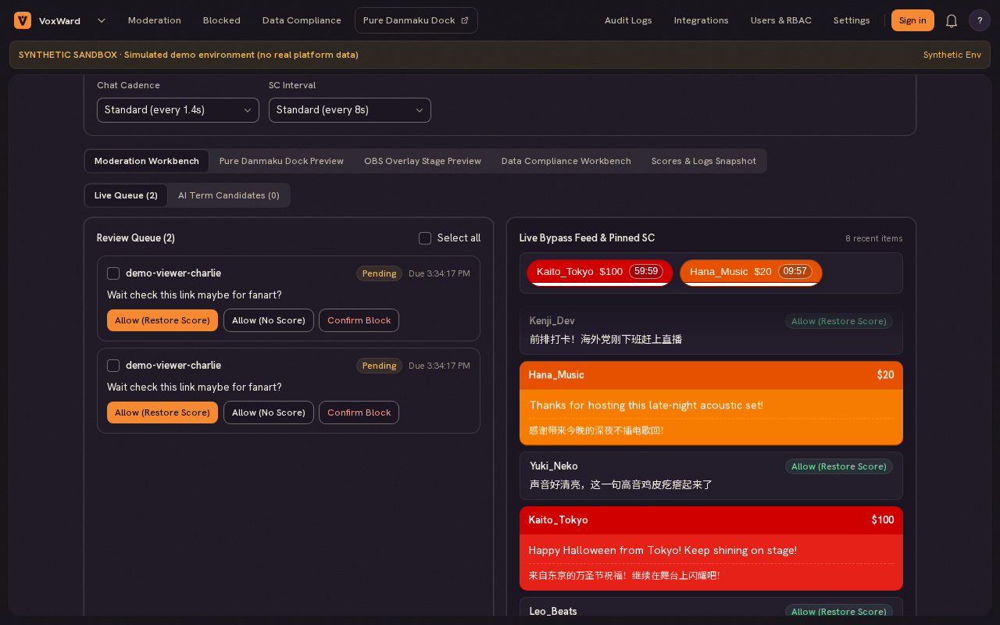
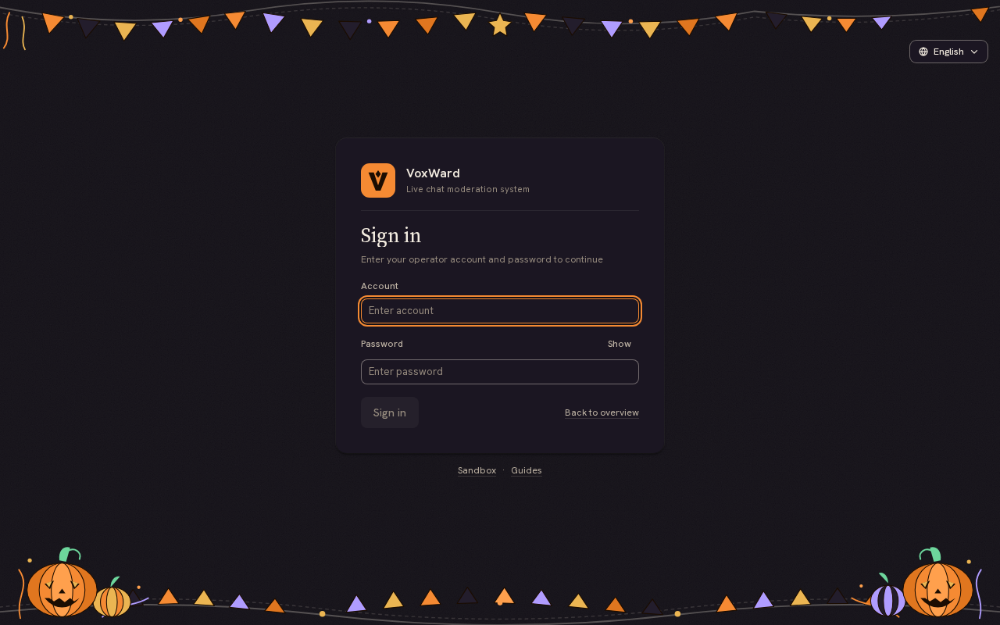
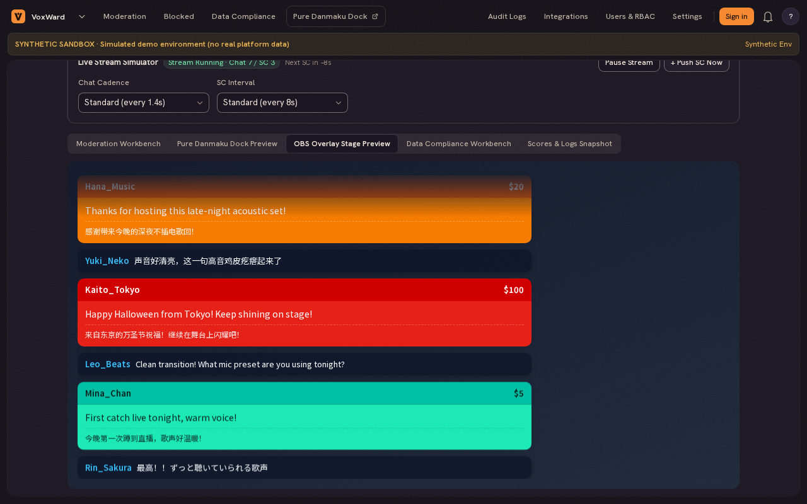
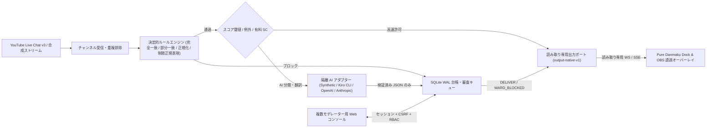

> 注：本ドキュメントは[英語版](./README.md)を正文とします · `synced-to: 3f5c65f612537959611e4bdfb684ed7542ef3a8f945f802921244f1fee92951a`

<div align="center">

<picture>
  <source media="(prefers-color-scheme: dark)" srcset="./docs/assets/voxward-icon-dark.svg">
  <source media="(prefers-color-scheme: light)" srcset="./docs/assets/voxward-icon.svg">
  
</picture>

# VoxWard

多言語 VTuber 配信向けのリアルタイム弾幕・チャットモデレーション、チャンネル内信頼スコア管理、Super Chat 翻訳ミドルウェア。

[English](./README.md) · [简体中文](./README.zh-CN.md) · **日本語** · [한국어](./README.ko.md) · [Français](./README.fr.md)

[](https://github.com/tpmoonchefryan/Voxward/releases/tag/rc0.1.0)
[](https://voxward.tcrn-platform.com/sandbox)
[](./LICENSE)
[](./docs/KIROWEEN.md)
[](https://github.com/tpmoonchefryan/Voxward/discussions)

[画面プレビュー](#画面プレビュー) · [クイックスタート](#kiroween-2026-審査員向けクイックスタート) · [アーキテクチャ](#frankenstein-アーキテクチャ) · [セルフホスト](#セルフホスト運用) · [ロードマップ](#v10-ロードマップ) · [ドキュメント](#ドキュメント一覧)

</div>

> [!NOTE]
> **tpmoonchefryan** が **Apache-2.0** の下で **Kiroween 2026（Frankenstein トラック）** 向けに開発しました。初期画面は **Halloween テーマ + 英語（`en`）** で起動し、UI から **5 言語**（`English`、`简体中文`、`日本語`、`한국어`、`Français`）へ即座に切り替えられます。

> [!IMPORTANT]
> **プレリリースのお知らせ**：現在の `rc0.1.0` は**プレリリース版**であり、実際の配信環境での本番検証は未実施です。実配信での導入・試用をご希望の配信者・運営チームの方は、[**GitHub Discussions**](https://github.com/tpmoonchefryan/Voxward/discussions) より直接ご連絡ください。実際の需要を踏まえ、本番検証済みバージョンの提供を検討・推進します。

---

## VoxWard の役割

多言語配信のコメント欄は高頻度かつ雑多で、配信者はスパムを防ぎつつ高額な Super Chat を正確に拾う必要があります。既存の運用では、単純な NG ワード一覧か、重い汎用ボットツールのどちらかに偏りがちです。

VoxWard は責務を分離したセルフホスト型ミドルウェアとして設計されています：

- **高速なルール処理**：完全一致・部分一致・正規化・同音示唆・制限付き正規表現と SQLite WAL トランザクションのチャンネル内信頼スコアで通常コメントを即座に判定します。
- **隔離された AI 判定**：境界判定や Super Chat は一時 ID（`item-*`）のみを用いた単発の AI ワーカーへルーティングされ、スキーマ検証済み JSON のみを返します。OAuth トークンやプラットフォームの実ユーザー ID はプロンプトに含めません。
- **読み取り専用の下流出力**：Pure Danmaku Dock（`/dock/:channelId`）と透過 OBS オーバーレイ（`/overlay/:channelId#cred=vwo_...`）には `ALLOW` / `WARD_BLOCKED` のみが出力され、内部スコアやモデレーション操作 UI は一切表示しません。

---

## 画面プレビュー



*初期設定の Halloween テーマ + 英語 UI によるインタラクティブサンドボックス画面：ライブストリームシミュレーター、分割保留キュー、カウントダウン付きピン留め SC バー、対訳 Super Chat カード。*

<table>
  <tr>
    <td width="50%" align="center">
      
      <br>
      <sub><b>標準ログイン画面（<code>/login</code>）</b> · Halloween テーマ + 5 言語切替</sub>
    </td>
    <td width="50%" align="center">
      
      <br>
      <sub><b>読み取り専用 OBS オーバーレイプレビュー</b> · 透過向け多言語チャット・SC 表示</sub>
    </td>
  </tr>
</table>

---

## Kiroween 2026 審査員向けクイックスタート

> **オンライン・サンドボックス（環境構築不要）**：ブラウザで **[https://voxward.tcrn-platform.com/sandbox](https://voxward.tcrn-platform.com/sandbox)** を開くだけで即座にお試しいただけます（ログイン、YouTube 認証情報、外部 LLM API キー不要）。

- **動作前提**：`Node.js >= 24`、`pnpm 12.18`（外部データベース不要 — 組込み SQLite WAL）。
- **技術スタック**：TypeScript、Fastify 5、React 19、Vite、Drizzle ORM + `better-sqlite3`、WebSocket (`ws`)、`@tcrn/ui-react@4.2.0`、Docker & k3s（`local-path` + Traefik）。

ローカル環境でも同じ**ゼロシークレットのサンドボックス環境**を起動できます（本番シークレットが設定されている場合は安全のため fail-closed で起動を拒否します）：

```bash
pnpm install --frozen-lockfile
pnpm build
node deploy/sandbox/start-sandbox.mjs
```

ブラウザで **`http://127.0.0.1:3100/sandbox`** を開いてください：

1. 初期状態は **Halloween テーマ + 英語（`en`）** です。右上のユーザーメニューから **5 言語** と **3 テーマ**（`halloween`、`light`、`dark`）を切り替えられます。
2. **Live Stream Simulator** により通常コメントとカウントダウン付きピン留め SC が連続再生されます（**`+ Push SC Now`** で即時挿入も可能）。
3. 6 つのプリセットシナリオを実行し、4 種のデモロール（**`Streamer View`、`Moderator View`、`Data Auditor`、`Stage Visitor`**）でモデレーション画面・Pure Dock・OBS ステージ・データ準拠パネル・スナップショットログの権限境界を確認できます。

ご自身の k3s 上でオンライン審査用デモをホストする場合は、ステートレスな [`deploy/k3s/sandbox/`](./deploy/k3s/sandbox/) オーバーレイを適用してください（詳細は [`deploy/k3s/README.md`](./deploy/k3s/README.md)）。

応募詳細は [Kiroween 2026 提出ガイド](./docs/KIROWEEN.md) を参照してください。

---

## Frankenstein アーキテクチャ



---

## 主な機能

| 領域 | 概要 | 主なソース |
| --- | --- | --- |
| **5 言語対応・テーマ切替** | `/login`、`/sandbox`、新規アカウントで `halloween` + `en` を初期値とし、`/auth/shell-preferences` で設定を永続化 | [`apps/web/src/i18n/`](./apps/web/src/i18n/), [`VoxWardShell.tsx`](./apps/web/src/shell/VoxWardShell.tsx) |
| **ライブ審査ワークベンチ** | 分割画面レビュー、一括判定、AI 候補ワード承認、スコア再判定 | [`ModerationPage.tsx`](./apps/web/src/pages/moderation/ModerationPage.tsx) |
| **Pure Dock & OBS ステージ** | 余計な管理表示を排した `/dock/:channelId` と URL フラグメント `#cred=vwo_...` 認証の `/overlay/:channelId` | [`DockPage.tsx`](./apps/web/src/pages/dock/DockPage.tsx), [`Stage.tsx`](./apps/web/src/pages/overlay/Stage.tsx), [`output-native-v1.md`](./docs/protocol/output-native-v1.md) |
| **ワードリストと CSV 管理** | 追記専用カテゴリ辞書、安全制限付き正規表現検証、CSV テンプレートダウンロード・一括インポート | [`AdminPage.tsx`](./apps/web/src/pages/admin/AdminPage.tsx) |
| **三値 RBAC と相関ログ** | `Deny > Grant > Not Set` 権限合成プレビュー、技術・変更・連携ログの双方向トレースと `<bdi>` 隔離 | [`UsersPage.tsx`](./apps/web/src/pages/users/UsersPage.tsx), [`LogViewer.tsx`](./apps/web/src/pages/logs/LogViewer.tsx) |
| **データ準拠と削除要求** | 視聴者参照検索、`DELETE_DATA_ONLY` / `DELETE_AND_EXCEPT` 登録・本人確認・非同期削除実行 | [`DataPanel.tsx`](./apps/web/src/pages/data/DataPanel.tsx) |

---

## Built with Kiro

本リポジトリには開発で活用した Kiro アーティファクトが含まれています：

- **Steering ルール**：[`.kiro/steering/`](./.kiro/steering/)
- **仕様・受け入れ記録**：[`.kiro/specs/`](./.kiro/specs/)
- **Skill / ローカルハーネス**：[`.kiro/skills/mana-orchestrate/`](./.kiro/skills/mana-orchestrate/), [`.kiro/README.md`](./.kiro/README.md)

## リポジトリ構成

```text
Voxward/
├── apps/server/        # Fastify 5 API/WS サーバー、SQLite WAL、AI アダプター
├── apps/web/           # React 19 + Vite 管理画面、Pure Dock、OBS オーバーレイ
├── packages/contracts/ # 判定結果・タスク状態・出力プロトコル共有契約
├── deploy/             # ゼロシークレット環境、k3s マニフェスト、Linux テンプレート
├── docs/               # 構築ガイド、OBS/YouTube 設定、5 言語訳、画像資産
└── .kiro/              # Steering ルール、スペック、ハーネス設定
```

---

## セルフホスト運用

本番デプロイは HTTPS リバースプロキシ（Caddy 等）背後の Linux サーバー（`127.0.0.1:3000` ループバック待機）、またはマルチステージ [`Dockerfile`](./Dockerfile) と [`deploy/k3s/`](./deploy/k3s/) Kustomize マニフェストによる単一ノード **k3s** クラスター（SQLite WAL 保護のため `replicas: 1` + `Recreate` + `local-path` RWO、`enableServiceLinks: false`、Traefik HTTPS/WSS、`HttpOnly; Secure; SameSite=Strict` Cookie、ワンタイムオーナー初期化）に対応しています。

- Linux systemd / プロキシテンプレート：[`deploy/server/README.md`](./deploy/server/README.md)
- k3s コンテナ・マニフェスト（`/sandbox` + 本番）：[`deploy/k3s/README.md`](./deploy/k3s/README.md)
- リモート構築手順：[`docs/deployment/remote-deploy.md`](./docs/deployment/remote-deploy.md)
- OBS / YouTube 連携設定：[`docs/obs/setup.md`](./docs/obs/setup.md), [`docs/deployment/youtube-credentials.md`](./docs/deployment/youtube-credentials.md)

### 検証範囲と外部未検証境界

`rc0.1.0` では `pnpm check:deps`、`pnpm check:ds`、`pnpm typecheck`、`pnpm build`、`node scripts/deploy-check.mjs --env-file deploy/server/server.env.example`、`pnpm test -- --run`（187 ファイル / 2,019 テスト）および Playwright E2E を完了しています。

コンテナ・オンラインサンドボックスの実機検証：マルチステージ [`Dockerfile`](./Dockerfile) は Cloud Build で正常にビルドされ、k3s `/sandbox` 構成は **[https://voxward.tcrn-platform.com/sandbox](https://voxward.tcrn-platform.com/sandbox)** にて公開 HTTPS と Playwright E2E で稼働確認済みです。

外部アカウントを要するため合成テスト対象外としている項目（[`docs/deployment/troubleshooting-and-quotas.md`](./docs/deployment/troubleshooting-and-quotas.md) および [`deploy/kiro-runtime/README.md`](./deploy/kiro-runtime/README.md) 参照）：

- 隔離 Linux ユーザー下での実 `kiro-cli` 実行（`VW-S029-KIRO-REAL`）および実モデルのレイテンシ・コスト計測（`VOXWARD-SUB-050`）。
- 運用者自身の Google Cloud プロジェクトによる YouTube OAuth 審査・クオータ申請とプラットフォーム規約確認。
- セルフホスト本番向け k3s マニフェスト（[`deploy/k3s/production/`](./deploy/k3s/production/)：`local-path` RWO PVC およびワンタイムオーナー初期化）は YAML 構文と不変条件を静的検証済みであり、実運用クラスターでの適用確認は各運用環境側で実施してください。

## v1.0 ロードマップ

1. **実配信 YouTube 連携と OAuth 審査検証**：運用者側の Google Cloud OAuth 審査を完了し、実クオータ環境下での長時間取り込み負荷試験を実施。
2. **実 AI ランタイム・コスト計測**：隔離 `kiro-cli`（`VW-S029-KIRO-REAL`）および商用 LLM プロバイダーにおける実遅延・トークンコストの計測（`VOXWARD-SUB-050`）。
3. **配信者パイロットと本番品質版の提供**：[**GitHub Discussions**](https://github.com/tpmoonchefryan/Voxward/discussions) を通じて希望する配信者と試験導入を行い、フィードバックを反映した本番検証済み v1.0 をリリース。

---

## ドキュメント一覧

| ドキュメント | 内容 | 言語 |
| --- | --- | --- |
| [`docs/KIROWEEN.md`](./docs/KIROWEEN.md) | Kiroween 2026 審査ガイドと Frankenstein 構成 | English |
| [`SECURITY.md`](./SECURITY.md) | サポートバージョン、GitHub Private Vulnerability Reporting、信頼境界 | [EN](./SECURITY.md) · [zh-CN](./docs/i18n/zh-CN/SECURITY.md) · [JA](./docs/i18n/ja/SECURITY.md) · [KO](./docs/i18n/ko/SECURITY.md) · [FR](./docs/i18n/fr/SECURITY.md) |
| [`PRIVACY.md`](./PRIVACY.md) | セルフホスト処理範囲、AI 最小送信原則、プラットフォーム原本との境界 | [EN](./PRIVACY.md) · [zh-CN](./docs/i18n/zh-CN/PRIVACY.md) · [JA](./docs/i18n/ja/PRIVACY.md) · [KO](./docs/i18n/ko/PRIVACY.md) · [FR](./docs/i18n/fr/PRIVACY.md) |
| [`CONTRIBUTING.md`](./CONTRIBUTING.md) | 開発環境、検証ゲート、多言語ドキュメント同期ルール | [EN](./CONTRIBUTING.md) · [zh-CN](./docs/i18n/zh-CN/CONTRIBUTING.md) · [JA](./docs/i18n/ja/CONTRIBUTING.md) · [KO](./docs/i18n/ko/CONTRIBUTING.md) · [FR](./docs/i18n/fr/CONTRIBUTING.md) |
| [`CODE_OF_CONDUCT.md`](./CODE_OF_CONDUCT.md) | 行動規範と非公開の報告手順 | [EN](./CODE_OF_CONDUCT.md) · [zh-CN](./docs/i18n/zh-CN/CODE_OF_CONDUCT.md) · [JA](./docs/i18n/ja/CODE_OF_CONDUCT.md) · [KO](./docs/i18n/ko/CODE_OF_CONDUCT.md) · [FR](./docs/i18n/fr/CODE_OF_CONDUCT.md) |
| [`CHANGELOG.md`](./CHANGELOG.md) | リリース変更履歴（`rc0.1.0`） | English |
| [`deploy/k3s/README.md`](./deploy/k3s/README.md) | k3s コンテナビルド、オンライン `/sandbox` およびセルフホスト本番マニフェスト | English |
| [`LICENSE`](./LICENSE) & [`NOTICE`](./NOTICE) | Apache-2.0 ライセンスおよび SIL OFL 1.1 フォントを含む第三者表記 | English (authoritative) |
