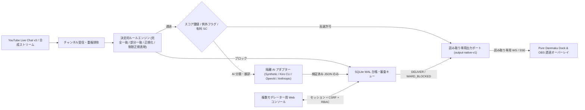

> 注：本ドキュメントは[英語版](./README.md)を正文とします · `synced-to: ed4a3f04d6252f8b49e1d2f0af7615e782f96c8571a84329221b8e43caed2196`

<div align="center">

# VoxWard

多言語 VTuber 配信向けのリアルタイム弾幕・チャットモデレーション、チャンネル内信頼スコア管理、Super Chat 翻訳ミドルウェア。

[English](./README.md) · [简体中文](./README.zh-CN.md) · **日本語** · [한국어](./README.ko.md) · [Français](./README.fr.md)

[](https://github.com/tpmoonchefryan/Voxward/releases/tag/rc0.1.0)
[](./LICENSE)
[](./docs/KIROWEEN.md)

[Kiroween 審査員向けクイックスタート](#kiroween-2026-審査員向けクイックスタート) · [アーキテクチャ](#frankenstein-アーキテクチャ) · [主な機能](#主な機能) · [セルフホスト運用](#セルフホスト運用) · [ドキュメント一覧](#ドキュメント一覧)

</div>

> [!NOTE]
> **tpmoonchefryan** が **Apache-2.0** の下で **Kiroween 2026（Frankenstein トラック）** 向けに開発しました。初期画面は **Halloween テーマ + 英語（`en`）** で起動し、UI から **5 言語**（`English`、`简体中文`、`日本語`、`한국어`、`Français`）へ即座に切り替えられます。

---

## VoxWard の役割

多言語配信のコメント欄は高頻度かつ雑多で、配信者はスパムを防ぎつつ高額な Super Chat を正確に拾う必要があります。既存の運用では、単純な NG ワード一覧か、重い汎用ボットツールのどちらかに偏りがちです。

VoxWard は責務を分離したセルフホスト型ミドルウェアとして設計されています：

- **高速なルール処理**：完全一致・部分一致・正規化・同音示唆・制限付き正規表現と SQLite WAL トランザクションのチャンネル内信頼スコアで通常コメントを即座に判定します。
- **隔離された AI 判定**：境界判定や Super Chat は一時 ID（`item-*`）のみを用いた単発の AI ワーカーへルーティングされ、スキーマ検証済み JSON のみを返します。OAuth トークンやプラットフォームの実ユーザー ID はプロンプトに含めません。
- **読み取り専用の下流出力**：Pure Danmaku Dock（`/dock/:channelId`）と透過 OBS オーバーレイ（`/overlay/:channelId#cred=vwo_...`）には `ALLOW` / `WARD_BLOCKED` のみが出力され、内部スコアやモデレーション操作 UI は一切表示しません。

---

## Kiroween 2026 審査員向けクイックスタート

Google Cloud 認証情報、YouTube OAuth トークン、外部 AI API キーなしで**ゼロシークレットのサンドボックス環境**を起動できます（本番シークレットが設定されている場合は安全のため fail-closed で起動を拒否します）：

```bash
pnpm install --frozen-lockfile
pnpm build
node deploy/sandbox/start-sandbox.mjs
```

ブラウザで **`http://127.0.0.1:3100/sandbox`** を開いてください：

1. 初期状態は **Halloween テーマ + 英語（`en`）** です。右上のユーザーメニューから **5 言語** と **3 テーマ**（`halloween`、`light`、`dark`）を切り替えられます。
2. **Live Stream Simulator** により通常コメントとカウントダウン付きピン留め SC が連続再生されます（**`+ Push SC Now`** で即時挿入も可能）。
3. 6 つのプリセットシナリオを実行し、4 種のデモロール（**`Streamer View`、`Moderator View`、`Data Auditor`、`Stage Visitor`**）でモデレーション画面・Pure Dock・OBS ステージ・データ準拠パネル・スナップショットログの権限境界を確認できます。

k3s 上でオンライン審査用デモをホストする場合は、ステートレスな [`deploy/k3s/sandbox/`](./deploy/k3s/sandbox/) オーバーレイを適用してください（詳細は [`deploy/k3s/README.md`](./deploy/k3s/README.md)）。

応募詳細は [Kiroween 2026 提出ガイド](./docs/KIROWEEN.md) を参照してください。

---

## Frankenstein アーキテクチャ



---

## 主な機能

| 領域 | 概要 | 主なソース |
| --- | --- | --- |
| **5 言語対応・テーマ切替** | `/login`、`/sandbox`、新規アカウントで `halloween` + `en` を初期値とし、`/auth/shell-preferences` で設定を永続化 | [`apps/web/src/i18n/`](./apps/web/src/i18n/), [`VoxWardShell.tsx`](./apps/web/src/shell/VoxWardShell.tsx) |
| **ライブ審査ワークベンチ** | 分割画面レビュー、一括判定、AI 候補ワード承認、スコア再判定 | [`ModerationPage.tsx`](./apps/web/src/pages/moderation/ModerationPage.tsx) |
| **Pure Dock & OBS ステージ** | 余計な管理表示を排した `/dock/:channelId` と URL フラグメント `#cred=vwo_...` 認証の `/overlay/:channelId` | [`DockPage.tsx`](./apps/web/src/pages/dock/DockPage.tsx), [`Stage.tsx`](./apps/web/src/pages/overlay/Stage.tsx), [`output-native-v1.md`](./docs/protocol/output-native-v1.md) |
| **ワードリストと CSV 管理** | 追記専用カテゴリ辞書、安全制限付き正規表現検証、CSV テンプレートダウンロード・一括インポート | [`AdminPage.tsx`](./apps/web/src/pages/admin/AdminPage.tsx) |
| **三値 RBAC と相関ログ** | `Deny > Grant > Not Set` 権限合成プレビュー、技術・変更・連携ログの双方向トレースと `<bdi>` 隔離 | [`UsersPage.tsx`](./apps/web/src/pages/users/UsersPage.tsx), [`LogViewer.tsx`](./apps/web/src/pages/logs/LogViewer.tsx) |
| **データ準拠と削除要求** | 視聴者参照検索、`DELETE_DATA_ONLY` / `DELETE_AND_EXCEPT` 登録・本人確認・非同期削除実行 | [`DataPanel.tsx`](./apps/web/src/pages/data/DataPanel.tsx) |

---

## Built with Kiro

本リポジトリには開発で活用した Kiro アーティファクトが含まれています：

- **Steering ルール**: [`.kiro/steering/`](./.kiro/steering/)
- **仕様・受け入れ記録**: [`.kiro/specs/`](./.kiro/specs/)
- **Skill / ローカルハーネス**: [`.kiro/skills/mana-orchestrate/`](./.kiro/skills/mana-orchestrate/), [`.kiro/README.md`](./.kiro/README.md)

---

## セルフホスト運用

本番デプロイは HTTPS リバースプロキシ（Caddy 等）背後の Linux サーバー（`127.0.0.1:3000` ループバック待機）、またはマルチステージ [`Dockerfile`](./Dockerfile) と [`deploy/k3s/`](./deploy/k3s/) Kustomize マニフェストによる単一ノード **k3s** クラスター（SQLite WAL 保護のため `replicas: 1` + `Recreate` + `local-path` RWO、`enableServiceLinks: false`、Traefik HTTPS/WSS、`HttpOnly; Secure; SameSite=Strict` Cookie、ワンタイムオーナー初期化）に対応しています。

- Linux systemd / プロキシテンプレート: [`deploy/server/README.md`](./deploy/server/README.md)
- k3s コンテナ・マニフェスト（`/sandbox` + 本番）: [`deploy/k3s/README.md`](./deploy/k3s/README.md)
- リモート構築手順: [`docs/deployment/remote-deploy.md`](./docs/deployment/remote-deploy.md)
- OBS / YouTube 連携設定: [`docs/obs/setup.md`](./docs/obs/setup.md), [`docs/deployment/youtube-credentials.md`](./docs/deployment/youtube-credentials.md)

### 検証範囲と外部未検証境界

`rc0.1.0` では `pnpm check:deps`、`pnpm check:ds`、`pnpm typecheck`、`pnpm build`、`node scripts/deploy-check.mjs --env-file deploy/server/server.env.example`、`pnpm test -- --run`（187 ファイル / 2,019 テスト）および Playwright E2E を完了しています。

外部アカウントを要するため合成テスト対象外としている項目（[`docs/deployment/troubleshooting-and-quotas.md`](./docs/deployment/troubleshooting-and-quotas.md) および [`deploy/kiro-runtime/README.md`](./deploy/kiro-runtime/README.md) 参照）：

- 隔離 Linux ユーザー下での実 `kiro-cli` 実行（`VW-S029-KIRO-REAL`）および実モデルのレイテンシ・コスト計測（`VOXWARD-SUB-050`）。
- 運用者自身の Google Cloud プロジェクトによる YouTube OAuth 審査・クオータ申請とプラットフォーム規約確認。
- コンテナおよび k3s デプロイ定義（[`Dockerfile`](./Dockerfile)、[`deploy/k3s/`](./deploy/k3s/)）は YAML 構文・ランタイム不変条件・パス衛生チェックの静的検証済みですが、実際の `docker build` およびクラスターへの `kubectl apply` はビルド環境および対象 k3s クラスターでの実行が必要です。

---

## ドキュメント一覧

| ドキュメント | 内容 | 言語 |
| --- | --- | --- |
| [`docs/KIROWEEN.md`](./docs/KIROWEEN.md) | Kiroween 2026 審査ガイドと Frankenstein 構成 | English |
| [`SECURITY.md`](./SECURITY.md) | サポートバージョン、GitHub Private Vulnerability Reporting、信頼境界 | [EN](./SECURITY.md) · [zh-CN](./docs/i18n/zh-CN/SECURITY.md) · [JA](./docs/i18n/ja/SECURITY.md) · [KO](./docs/i18n/ko/SECURITY.md) · [FR](./docs/i18n/fr/SECURITY.md) |
| [`PRIVACY.md`](./PRIVACY.md) | セルフホスト処理範囲、AI 最小送信原則、プラットフォーム原本との境界 | [EN](./PRIVACY.md) · [zh-CN](./docs/i18n/zh-CN/PRIVACY.md) · [JA](./docs/i18n/ja/PRIVACY.md) · [KO](./docs/i18n/ko/PRIVACY.md) · [FR](./docs/i18n/fr/PRIVACY.md) |
| [`CONTRIBUTING.md`](./CONTRIBUTING.md) | 開発環境、検証ゲート、多言語ドキュメント同期ルール | [EN](./CONTRIBUTING.md) · [zh-CN](./docs/i18n/zh-CN/CONTRIBUTING.md) · [JA](./docs/i18n/ja/CONTRIBUTING.md) · [KO](./docs/i18n/ko/CONTRIBUTING.md) · [FR](./docs/i18n/fr/CONTRIBUTING.md) |
| [`CODE_OF_CONDUCT.md`](./CODE_OF_CONDUCT.md) | 行動規範と非公開の報告手順 | [EN](./CODE_OF_CONDUCT.md) · [zh-CN](./docs/i18n/zh-CN/CODE_OF_CONDUCT.md) · [JA](./docs/i18n/ja/CODE_OF_CONDUCT.md) · [KO](./docs/i18n/ko/CODE_OF_CONDUCT.md) · [FR](./docs/i18n/fr/CODE_OF_CONDUCT.md) |
| [`CHANGELOG.md`](./CHANGELOG.md) | リリース変更履歴（`rc0.1.0`） | English |
| [`deploy/k3s/README.md`](./deploy/k3s/README.md) | k3s コンテナビルド、オンライン `/sandbox` およびセルフホスト本番マニフェスト | English |
| [`LICENSE`](./LICENSE) & [`NOTICE`](./NOTICE) | Apache-2.0 ライセンスおよび SIL OFL 1.1 フォントを含む第三者表記 | English (authoritative) |
