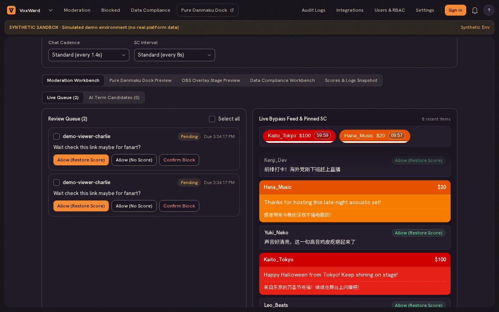
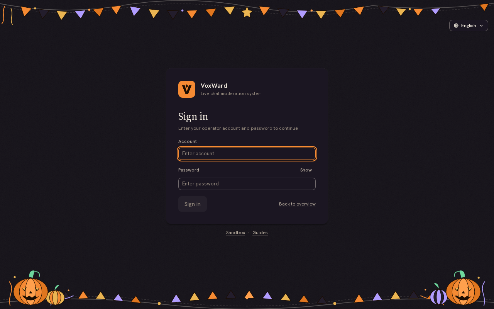
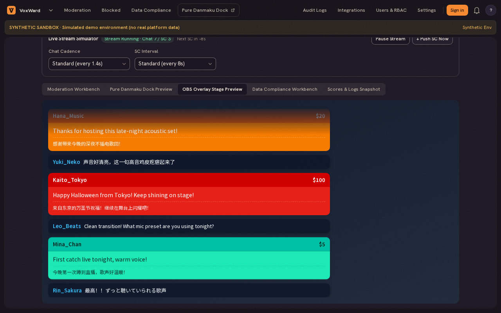
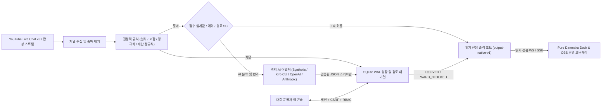

> 참고: 이 문서는 [영문 원본](./README.md)을 정본으로 합니다 · `synced-to: 27d8f9ec0339989539fa4558b628adbdb6f524883ba786a9e036639497e3f3f9`

<div align="center">

<picture>
  <source media="(prefers-color-scheme: dark)" srcset="./docs/assets/voxward-icon-dark.svg">
  <source media="(prefers-color-scheme: light)" srcset="./docs/assets/voxward-icon.svg">
  
</picture>

# VoxWard

다국어 VTuber 방송을 위한 실시간 탄막·채팅 검토, 채널 내 신뢰 점수 관리 및 Super Chat 번역 미들웨어.

[English](./README.md) · [简体中文](./README.zh-CN.md) · [日本語](./README.ja.md) · **한국어** · [Français](./README.fr.md)

[](https://github.com/tpmoonchefryan/Voxward/releases/tag/rc0.1.0)
[](https://voxward.tcrn-platform.com/sandbox)
[](./LICENSE)
[](./docs/KIROWEEN.md)
[](https://github.com/tpmoonchefryan/Voxward/discussions)

[화면 미리보기](#화면-미리보기) · [빠른 시작](#kiroween-2026-심사위원-빠른-시작) · [아키텍처](#frankenstein-아키텍처) · [셀프 호스팅](#셀프-호스팅-배포) · [로드맵](#v10-로드맵) · [문서 안내](#문서-안내)

</div>

> [!NOTE]
> **tpmoonchefryan** 이 **Apache-2.0** 라이선스로 **Kiroween 2026(Frankenstein 트랙)** 출품을 위해 개발했습니다. 초기 화면은 **Halloween 테마 + 영어(`en`)** 로 시작하며 UI에서 **5개 언어**(`English`, `简体中文`, `日本語`, `한국어`, `Français`)를 즉시 전환할 수 있습니다.

> [!IMPORTANT]
> **프리릴리스 안내**: 현재 `rc0.1.0`은 **프리릴리스 버전**이며 실제 방송 운영 환경에서의 프로덕션 테스트는 아직 수행되지 않았습니다. 실제 방송에서 사용을 희망하는 스트리머나 운영 팀은 [**GitHub Discussions**](https://github.com/tpmoonchefryan/Voxward/discussions) 로 직접 연락해 주세요. 실제 수요를 바탕으로 향후 프로덕션 검증 정식 버전 제공을 추진할 예정입니다.

---

## 왜 VoxWard 인가요

다국어 VTuber 라이브 방송은 빠르게 흐르는 일반 채팅과 스트리머가 놓쳐서는 안 되는 유료 메시지(Super Chat)가 동시에 몰립니다. 기존 도구들은 단순 키워드 차단기나 무거운 CRM 봇 중 하나를 선택해야 했습니다.

VoxWard는 역할을 명확히 나눈 셀프 호스팅 미들웨어입니다:

- **신뢰 기반 고속 경로**: 결정적 규칙 엔진(일치, 부분 문자열, 정규화, 유사 발음 힌트, 제한된 정규식)과 채널 전용 SQLite WAL 신뢰 점수 원장으로 일반 채팅을 즉시 처리합니다.
- **격리된 AI 에스컬레이션**: 경계성 채팅과 유료 Super Chat은 임시 항목 ID(`item-*`)와 구조화된 JSON 스키마 검증만 사용하는 일회성 AI 작업으로 라우팅되며, OAuth 비밀 키나 고정 플랫폼 사용자 ID를 프롬프트로 전달하지 않습니다.
- **읽기 전용 출력 대상**: Pure Danmaku Dock(`/dock/:channelId`)과 투명 OBS 오버레이(`/overlay/:channelId#cred=vwo_...`)는 `ALLOW` / `WARD_BLOCKED` 프레임만 수신하며 내부 점수나 관리 제어 UI를 노출하지 않습니다.

---

## 화면 미리보기



*기본 Halloween 테마 + 영어 UI 인터랙티브 샌드박스 워크벤치: 라이브 스트림 시뮬레이터, 분할 대기열, 카운트다운 고정 SC 바 및 이중 언어 번역 카드.*

<table>
  <tr>
    <td width="50%" align="center">
      
      <br>
      <sub><b>기본 로그인 화면 (<code>/login</code>)</b> · Halloween 테마 + 5개 언어 선택</sub>
    </td>
    <td width="50%" align="center">
      
      <br>
      <sub><b>읽기 전용 OBS 스테이지 미리보기</b> · 깔끔한 다국어 탄막 및 SC 스트림</sub>
    </td>
  </tr>
</table>

---

## Kiroween 2026 심사위원 빠른 시작

> **온라인 샌드박스(설치 불필요)**: 브라우저에서 **[https://voxward.tcrn-platform.com/sandbox](https://voxward.tcrn-platform.com/sandbox)** 를 바로 여세요(로그인, YouTube 키 또는 LLM API 키가 필요하지 않습니다).

- **실행 전제 조건**: `Node.js >= 24`, `pnpm 12.18` (외부 DB 불필요 — 내장 SQLite WAL 사용).
- **기술 스택**: TypeScript, Fastify 5, React 19, Vite, Drizzle ORM + `better-sqlite3`, WebSocket (`ws`), `@tcrn/ui-react@4.2.0`, Docker & k3s (`local-path` + Traefik).

로컬 환경에서도 동일한 **무비밀(Zero-Secret) 샌드박스**를 실행할 수 있습니다(운영 비밀 값이 감지되면 fail-closed로 시작을 거부합니다):

```bash
pnpm install --frozen-lockfile
pnpm build
node deploy/sandbox/start-sandbox.mjs
```

브라우저에서 **`http://127.0.0.1:3100/sandbox`** 를 여세요:

1. 기본 **Halloween 테마 + 영어(`en`)** 로 열리며, 오른쪽 상단 메뉴에서 **5개 언어**(`en`, `zh-CN`, `ja`, `ko`, `fr`)와 **3가지 테마**(`halloween`, `light`, `dark`)를 전환할 수 있습니다.
2. **Live Stream Simulator** 로 연속 채팅 흐름과 카운트다운 SC 알약을 확인하거나 **`+ Push SC Now`** 를 눌러 즉시 테스트할 수 있습니다.
3. 6가지 사전 시나리오를 실행하고 4가지 데모 역할(**`Streamer View`, `Moderator View`, `Data Auditor`, `Stage Visitor`**)을 오가며 검토 워크벤치, Pure Dock, OBS 스테이지, 데이터 규정 준수 패널, 스냅샷 로그를 검증할 수 있습니다.

직접 k3s에서 온라인 심사위원 데모를 호스팅하려면 상태 비저장 [`deploy/k3s/sandbox/`](./deploy/k3s/sandbox/) 오버레이를 적용하세요([`deploy/k3s/README.md`](./deploy/k3s/README.md) 참고).

자세한 내용은 [Kiroween 2026 제출 가이드](./docs/KIROWEEN.md)를 참고하세요.

---

## Frankenstein 아키텍처



---

## 핵심 기능

| 영역 | 주요 기능 | 핵심 경로 |
| --- | --- | --- |
| **5개 언어 및 테마 UI** | `/login`, `/sandbox`, 신규 계정 기본값 `halloween` + `en`; `zh-Hans` 태그 및 강타입 5개 언어 포맷터 지원 | [`apps/web/src/i18n/`](./apps/web/src/i18n/), [`VoxWardShell.tsx`](./apps/web/src/shell/VoxWardShell.tsx) |
| **실시간 검토 워크벤치** | 분할 대기열 검토, 일괄 판정, AI 후보 키워드 승격, 신뢰 점수 재판정, 다국어 SC 번역 | [`ModerationPage.tsx`](./apps/web/src/pages/moderation/ModerationPage.tsx) |
| **Pure Dock & OBS 스테이지** | `ScPayment` 카드 표시 `/dock/:channelId` 및 `OBS_OVERLAY`/`BLIVECHAT` 자격 분리 기반 `/overlay/:channelId` | [`DockPage.tsx`](./apps/web/src/pages/dock/DockPage.tsx), [`Stage.tsx`](./apps/web/src/pages/overlay/Stage.tsx), [`output-native-v1.en.md`](./docs/protocol/output-native-v1.en.md) |
| **단어장 및 CSV 일괄 처리** | 통합 언어 스코프 `rule_terms` + 스냅샷 롤백, 추가 전용 분류, RFC-4180 CSV(다중 인코딩/구분 기호 미리보기) | [`AdminPage.tsx`](./apps/web/src/pages/admin/AdminPage.tsx), [`term-csv.ts`](./apps/server/src/auth/term-csv.ts) |
| **3상태 RBAC 및 감사 로그** | `Deny > Grant > Not Set` 권한 합성, 구조화 `change_logs` (`summary_code`) 및 `<bdi>` 텍스트 격리 | [`UsersPage.tsx`](./apps/web/src/pages/users/UsersPage.tsx), [`LogViewer.tsx`](./apps/web/src/pages/logs/LogViewer.tsx) |
| **데이터 규정 준수 및 삭제** | 시청자 조회, `DELETE_DATA_ONLY` / `DELETE_AND_EXCEPT` 요청 등록·검증·비동기 정리 실행 | [`DataPanel.tsx`](./apps/web/src/pages/data/DataPanel.tsx) |

---

## Built with Kiro

이 저장소에는 개발에 사용된 Kiro 산출물이 함께 포함되어 있습니다:

- **Steering 규칙**: [`.kiro/steering/`](./.kiro/steering/)
- **단계별 Specs 및 인수 기록**: [`.kiro/specs/`](./.kiro/specs/)
- **프로젝트 Skill 및 로컬 하네스**: [`.kiro/skills/mana-orchestrate/`](./.kiro/skills/mana-orchestrate/), [`.kiro/README.md`](./.kiro/README.md)

## 저장소 구조

```text
Voxward/
├── apps/server/        # Fastify 5 REST/WS 서버, SQLite WAL 및 AI 어댑터
├── apps/web/           # React 19 + Vite 콘솔, Pure Dock 및 OBS 오버레이
├── packages/contracts/ # 판정 열거형, 작업 상태 및 공유 프로토콜 스키마
├── deploy/             # 무비밀 샌드박스, k3s 매니페스트 및 Linux 템플릿
├── docs/               # 배포 매뉴얼, OBS/YouTube 설정, 5개 언어 번역 및 자산
└── .kiro/              # Steering 규칙, 단계별 Specs 및 하네스 설정
```

---

## 셀프 호스팅 배포

운영 배포는 HTTPS 리버스 프록시(Caddy 등) 뒤의 Linux 서버(`127.0.0.1:3000` 루프백 바인딩) 또는 멀티 스테이지 [`Dockerfile`](./Dockerfile) 과 [`deploy/k3s/`](./deploy/k3s/) Kustomize 매니페스트 기반 단일 노드 **k3s** 클러스터(SQLite WAL 보호를 위한 `replicas: 1` + `Recreate` + `local-path` RWO, `enableServiceLinks: false`, Traefik HTTPS/WSS, `HttpOnly; Secure; SameSite=Strict` 쿠키, 일회성 소유자 부트스트랩)를 지원합니다.

- Linux systemd 및 프록시 템플릿: [`deploy/server/README.md`](./deploy/server/README.md)
- k3s 컨테이너 및 매니페스트(`/sandbox` + 운영): [`deploy/k3s/README.md`](./deploy/k3s/README.md)
- 원격 배포 매뉴얼: [`docs/deployment/remote-deploy.md`](./docs/deployment/remote-deploy.md)
- OBS 및 YouTube 연동: [`docs/obs/setup.en.md`](./docs/obs/setup.en.md) ([zh-CN](./docs/obs/setup.md)), [`docs/deployment/youtube-credentials.en.md`](./docs/deployment/youtube-credentials.en.md) ([zh-CN](./docs/deployment/youtube-credentials.md))

### 검증 범위 및 외부 미검증 경계

`rc0.1.0` 기준 로컬에서 `pnpm check:deps`, `pnpm check:ds`, `pnpm typecheck`, `pnpm build`, `node scripts/deploy-check.mjs --env-file deploy/server/server.env.example`, `pnpm test -- --run`(187개 파일, 2,019개 테스트) 및 Playwright E2E 검증을 통과했습니다.

컨테이너 및 온라인 샌드박스 실배포 검증: 멀티 스테이지 [`Dockerfile`](./Dockerfile) 은 Cloud Build에서 정상 빌드되었으며, k3s `/sandbox` 배포는 **[https://voxward.tcrn-platform.com/sandbox](https://voxward.tcrn-platform.com/sandbox)** 에서 실제 HTTPS 및 Playwright E2E 검증을 마쳤습니다.

실제 외부 자격 증명이 필요하여 합성 검증 범위에 포함되지 않는 경계([`docs/deployment/troubleshooting-and-quotas.md`](./docs/deployment/troubleshooting-and-quotas.md), [`deploy/kiro-runtime/README.md`](./deploy/kiro-runtime/README.md) 참고):

- 격리된 Linux 계정에서 실제 `kiro-cli` 런타임 실행(`VW-S029-KIRO-REAL`) 및 실제 모델 지연·비용 벤치마크(`VOXWARD-SUB-050`).
- 운영자의 Google Cloud 프로젝트 OAuth 앱 검증 및 YouTube API 할당량·정책 확인.
- 셀프 호스팅 운영용 k3s 매니페스트([`deploy/k3s/production/`](./deploy/k3s/production/), `local-path` RWO PVC 및 일회성 소유자 부트스트랩 포함)는 YAML 구문 및 불변 조건 정적 검증을 마쳤으며, 실제 적용은 운영자의 대상 클러스터에서 검증해야 합니다.

## v1.0 로드맵

1. **실제 YouTube 라이브 연동 및 OAuth 검증**: 운영자 Google Cloud OAuth 앱 검증을 완료하고 실제 채널 할당량 환경에서 장시간 부하 테스트를 진행합니다.
2. **실제 AI 런타임 벤치마크**: 격리된 `kiro-cli`(`VW-S029-KIRO-REAL`) 및 상용 LLM 제공자의 실제 지연 시간·비용 지표를 측정합니다(`VOXWARD-SUB-050`).
3. **스트리머 파일럿 및 프로덕션 안정화**: [**GitHub Discussions**](https://github.com/tpmoonchefryan/Voxward/discussions) 로 참여한 스트리머와 실방송 시범 운영을 진행한 뒤 프로덕션 검증을 마친 v1.0을 출시합니다.

---

## 문서 안내

| 문서 | 범위 | 언어 |
| --- | --- | --- |
| [`docs/KIROWEEN.md`](./docs/KIROWEEN.md) | Kiroween 2026 제출 개요, 아키텍처 및 Kiro 매핑 | English |
| [`docs/multilingual.md`](./docs/multilingual.md) | BCP 47 콘텐츠 언어, 다국어 SC v2 번역, CSV 및 구조화 i18n | English |
| [`docs/protocol/output-native-v1.en.md`](./docs/protocol/output-native-v1.en.md) | 읽기 전용 출력 WebSocket 프로토콜 (`vw-output.v1`) | [EN](./docs/protocol/output-native-v1.en.md) · [zh-CN](./docs/protocol/output-native-v1.md) |
| [`docs/obs/setup.en.md`](./docs/obs/setup.en.md) | OBS Browser Source (`#cred`) 및 Custom Dock 가이드 | [EN](./docs/obs/setup.en.md) · [zh-CN](./docs/obs/setup.md) |
| [`docs/deployment/youtube-credentials.en.md`](./docs/deployment/youtube-credentials.en.md) | YouTube API OAuth 범위, 콜백 규칙 및 할당량 문제 해결 | [EN](./docs/deployment/youtube-credentials.en.md) · [zh-CN](./docs/deployment/youtube-credentials.md) / [Troubleshooting (EN)](./docs/deployment/troubleshooting-and-quotas.en.md) |
| [`docs/integrations/support-matrix.en.md`](./docs/integrations/support-matrix.en.md) | 다운스트림 연동 지원 범위 및 루프백 경계 | [EN](./docs/integrations/support-matrix.en.md) · [zh-CN](./docs/integrations/support-matrix.md) |
| [`SECURITY.md`](./SECURITY.md) | 지원 버전, GitHub Private Vulnerability Reporting 및 보안 경계 | [EN](./SECURITY.md) · [zh-CN](./docs/i18n/zh-CN/SECURITY.md) · [JA](./docs/i18n/ja/SECURITY.md) · [KO](./docs/i18n/ko/SECURITY.md) · [FR](./docs/i18n/fr/SECURITY.md) |
| [`PRIVACY.md`](./PRIVACY.md) | 셀프 호스팅 데이터 처리, AI 최소화 및 플랫폼 원본 경계 | [EN](./PRIVACY.md) · [zh-CN](./docs/i18n/zh-CN/PRIVACY.md) · [JA](./docs/i18n/ja/PRIVACY.md) · [KO](./docs/i18n/ko/PRIVACY.md) · [FR](./docs/i18n/fr/PRIVACY.md) |
| [`CONTRIBUTING.md`](./CONTRIBUTING.md) | 개발 환경, 검증 게이트 및 5개 언어 문서 동기화 규칙 | [EN](./CONTRIBUTING.md) · [zh-CN](./docs/i18n/zh-CN/CONTRIBUTING.md) · [JA](./docs/i18n/ja/CONTRIBUTING.md) · [KO](./docs/i18n/ko/CONTRIBUTING.md) · [FR](./docs/i18n/fr/CONTRIBUTING.md) |
| [`CODE_OF_CONDUCT.md`](./CODE_OF_CONDUCT.md) | 커뮤니티 행동 강령 및 비공개 신고 안내 | [EN](./CODE_OF_CONDUCT.md) · [zh-CN](./docs/i18n/zh-CN/CODE_OF_CONDUCT.md) · [JA](./docs/i18n/ja/CODE_OF_CONDUCT.md) · [KO](./docs/i18n/ko/CODE_OF_CONDUCT.md) · [FR](./docs/i18n/fr/CODE_OF_CONDUCT.md) |
| [`CHANGELOG.md`](./CHANGELOG.md) | 릴리스 변경 이력 (`rc0.1.0`) | English |
| [`deploy/k3s/README.md`](./deploy/k3s/README.md) | k3s 컨테이너 빌드, 온라인 `/sandbox` 및 셀프 호스팅 운영 매니페스트 | English |
| [`LICENSE`](./LICENSE) & [`NOTICE`](./NOTICE) | Apache-2.0 라이선스 및 SIL OFL 1.1 폰트를 포함한 제3자 고지 | English (authoritative) |
