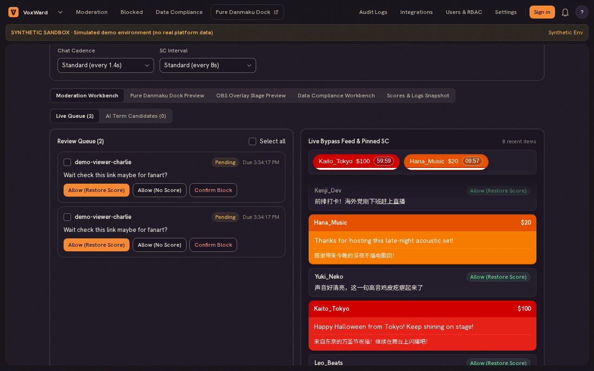
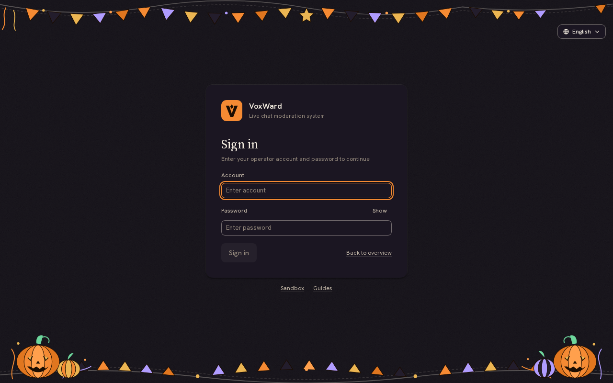
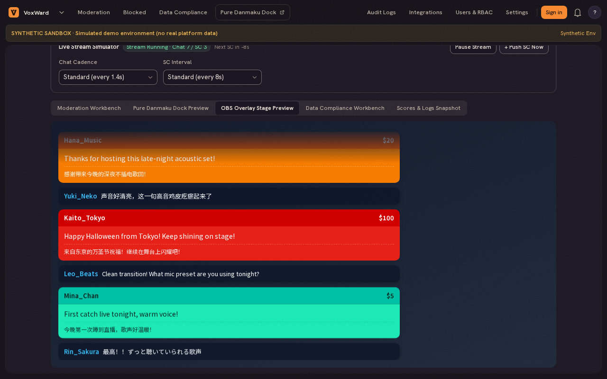
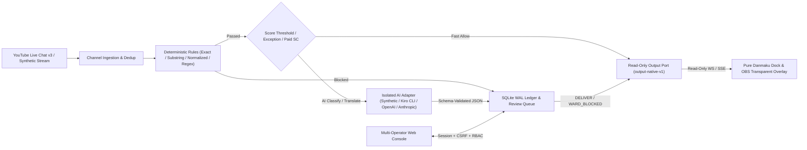

<div align="center">

<picture>
  <source media="(prefers-color-scheme: dark)" srcset="./docs/assets/voxward-icon-dark.svg">
  <source media="(prefers-color-scheme: light)" srcset="./docs/assets/voxward-icon.svg">
  
</picture>

# VoxWard

Cross-language livestream danmaku & chat moderation, channel-scoped trust scoring, and Super Chat translation middleware for VTuber broadcasts.

**English** · [简体中文](./README.zh-CN.md) · [日本語](./README.ja.md) · [한국어](./README.ko.md) · [Français](./README.fr.md)

[](https://github.com/tpmoonchefryan/Voxward/releases/tag/rc0.1.0)
[](https://voxward.tcrn-platform.com/sandbox)
[](./LICENSE)
[](./docs/KIROWEEN.md)
[](https://github.com/tpmoonchefryan/Voxward/discussions)

[Previews](#interface-preview) · [Judge Quickstart](#kiroween-2026-judge-quickstart) · [Architecture](#frankenstein-architecture) · [Self-Hosting](#self-hosted-deployment) · [Roadmap](#roadmap-toward-v10) · [Documentation](#documentation-index)

</div>

> [!NOTE]
> Built by **tpmoonchefryan** for **Kiroween 2026 (Frankenstein Track)** under **Apache-2.0**. The default experience ships in **Halloween theme + English (`en`)** with live 5-language switching (`English`, `简体中文`, `日本語`, `한국어`, `Français`).

> [!IMPORTANT]
> **Pre-Release Notice**: `rc0.1.0` is a **pre-release candidate** and has **not yet been validated in live broadcast production**. Streamers or VTuber channels interested in real-world deployment are warmly encouraged to contact the maintainer via [**GitHub Discussions**](https://github.com/tpmoonchefryan/Voxward/discussions) — real streamer demand will guide a future production-validated release.

---

## Why VoxWard

Live VTuber streams mix fast, noisy multilingual chat with high-value paid messages (Super Chats) that hosts need to read quickly and safely. Existing tools force hosts to pick between brittle keyword blacklists or heavyweight CRM bots.

VoxWard separates concerns cleanly into a self-hosted middleware:

- **Trusted fast path**: Deterministic matching (exact, substring, normalized, homophone hints, bounded regex) + channel-scoped SQLite WAL trust scores handle high-volume chat immediately.
- **Selective AI escalation**: Ambiguous chat and paid Super Chats route to isolated one-shot AI workers with temporary item IDs (`item-*`) and structured JSON schema validation — never exposing OAuth secrets or stable user IDs to prompts.
- **Read-only downstream displays**: Pure Danmaku Dock (`/dock/:channelId`) and transparent OBS Overlay (`/overlay/:channelId#cred=vwo_...`) receive strictly `ALLOW` / `WARD_BLOCKED` events with zero moderation buttons or internal scores.

---

## Interface Preview



*Interactive Sandbox Moderation Desk in default Halloween theme + English: live stream simulator, split pending queue, pinned countdown Super Chat bar, and bilingual SC translation cards.*

<table>
  <tr>
    <td width="50%" align="center">
      
      <br>
      <sub><b>Default Login (<code>/login</code>)</b> · Halloween theme + 5-language selector</sub>
    </td>
    <td width="50%" align="center">
      
      <br>
      <sub><b>Read-Only OBS Overlay Stage</b> · Clean multilingual danmaku &amp; SC stream</sub>
    </td>
  </tr>
</table>

---

## Kiroween 2026 Judge Quickstart

> **Live Online Sandbox (Zero Setup)**: Open **[https://voxward.tcrn-platform.com/sandbox](https://voxward.tcrn-platform.com/sandbox)** directly in your browser (no login, YouTube key, or LLM key required).

- **Runtime Prerequisites**: `Node.js >= 24`, `pnpm 12.18` (zero external database needed — embedded SQLite WAL).
- **Tech Stack**: TypeScript, Fastify 5, React 19, Vite, Drizzle ORM + `better-sqlite3`, WebSocket (`ws`), `@tcrn/ui-react@4.2.0`, Docker & k3s (`local-path` + Traefik).

Reviewers can also run the complete frontend + backend pipeline locally in **zero-credential Sandbox mode** (no YouTube API key or LLM API key required; the launcher fails closed if real production secrets are present):

```bash
pnpm install --frozen-lockfile
pnpm build
node deploy/sandbox/start-sandbox.mjs
```

Open **`http://127.0.0.1:3100/sandbox`** in your browser:

1. Starts in **Halloween** theme + **English (`en`)** by default; use the top-right user menu to switch across **5 languages** (`en`, `zh-CN`, `ja`, `ko`, `fr`) and **3 themes** (`halloween`, `light`, `dark`).
2. Watch the **Live Stream Simulator** push continuous danmaku and timed Super Chat pills (or click **`+ Push SC Now`**).
3. Run the 6 preset scenarios and switch between **`Streamer View`**, **`Moderator View`**, **`Data Auditor`**, and **`Stage Visitor`** across the Moderation Desk, Pure Dock, OBS Stage Preview, Data Compliance Panel, and Snapshot Log views.

To host your own online judge demo on k3s, apply the stateless [`deploy/k3s/sandbox/`](./deploy/k3s/sandbox/) overlay (see [`deploy/k3s/README.md`](./deploy/k3s/README.md)).

For full contest notes, see [Kiroween 2026 Submission Guide](./docs/KIROWEEN.md).

---

## Frankenstein Architecture



---

## Core Capabilities

| Area | Highlight | Key Paths |
| --- | --- | --- |
| **Multilingual & Themeable UI** | Halloween default on `/login`, `/sandbox`, and fresh accounts; live switching across `en`, `zh-CN`, `ja`, `ko`, `fr` backed by `/auth/shell-preferences` | [`apps/web/src/i18n/`](./apps/web/src/i18n/), [`VoxWardShell.tsx`](./apps/web/src/shell/VoxWardShell.tsx) |
| **Live Moderation & Queue** | Split-view review workbench, bulk verdicts, candidate keyword promotion, score rejudgement | [`ModerationPage.tsx`](./apps/web/src/pages/moderation/ModerationPage.tsx) |
| **Pure Dock & OBS Overlay** | Standalone clean chat + countdown Super Chat pills (`/dock/:channelId`) and `#cred=vwo_...` fragment-only OBS WebSocket stage (`/overlay/:channelId`) | [`DockPage.tsx`](./apps/web/src/pages/dock/DockPage.tsx), [`Stage.tsx`](./apps/web/src/pages/overlay/Stage.tsx), [`output-native-v1.md`](./docs/protocol/output-native-v1.md) |
| **Wordlists & CSV Workflows** | Append-only category dictionary, bounded regex validation, CSV template download + bulk import, scoring & retention controls | [`AdminPage.tsx`](./apps/web/src/pages/admin/AdminPage.tsx) |
| **Tri-State RBAC & Audit Chain** | `Deny > Grant > Not Set` multi-role permission synthesis, bidirectional technical/change/integration log trace with `<bdi>` isolation | [`UsersPage.tsx`](./apps/web/src/pages/users/UsersPage.tsx), [`LogViewer.tsx`](./apps/web/src/pages/logs/LogViewer.tsx) |
| **Data Compliance & Privacy** | Subject lookup, `DELETE_DATA_ONLY` / `DELETE_AND_EXCEPT` async cleanup registration, verification, and execution wiring | [`DataPanel.tsx`](./apps/web/src/pages/data/DataPanel.tsx) |

---

## Built with Kiro

This repository preserves its Kiro development artifacts in-tree:

- **Steering Rules**: [`.kiro/steering/`](./.kiro/steering/)
- **Incremental Specs & Acceptance Evidence**: [`.kiro/specs/`](./.kiro/specs/)
- **Local Skills & Harness Metadata**: [`.kiro/skills/mana-orchestrate/`](./.kiro/skills/mana-orchestrate/), [`.kiro/README.md`](./.kiro/README.md)

## Repository Structure

```text
Voxward/
├── apps/server/        # Fastify 5 REST/WS server, SQLite WAL & AI adapters
├── apps/web/           # React 19 + Vite console, pure dock & OBS overlay
├── packages/contracts/ # Shared verdicts, task states & protocol schemas
├── deploy/             # Zero-secret sandbox, k3s manifests & Linux templates
├── docs/               # Deployment guides, OBS/YouTube setup, i18n & assets
└── .kiro/              # Steering rules, incremental specs & harness config
```

---

## Self-Hosted Deployment

Production deployment targets self-hosted Linux servers behind an HTTPS reverse proxy (such as Caddy) bound to loopback (`127.0.0.1:3000`) or single-node **k3s** clusters via the multi-stage [`Dockerfile`](./Dockerfile) and Kustomize manifests under [`deploy/k3s/`](./deploy/k3s/) (`replicas: 1` + `Recreate` + `local-path` RWO for SQLite WAL, `enableServiceLinks: false`, Traefik HTTPS/WSS, strict `HttpOnly; Secure; SameSite=Strict` cookies, and one-time owner bootstrap).

- Linux systemd & reverse-proxy templates: [`deploy/server/README.md`](./deploy/server/README.md)
- k3s container & manifests (`/sandbox` + production): [`deploy/k3s/README.md`](./deploy/k3s/README.md)
- Detailed remote deploy runbook: [`docs/deployment/remote-deploy.md`](./docs/deployment/remote-deploy.md)
- OBS & YouTube setup: [`docs/obs/setup.md`](./docs/obs/setup.md), [`docs/deployment/youtube-credentials.md`](./docs/deployment/youtube-credentials.md)

### Current Verification & External Boundaries

Local engineering checks verified at release candidate `rc0.1.0`: `pnpm check:deps`, `pnpm check:ds`, `pnpm typecheck`, `pnpm build`, `node scripts/deploy-check.mjs --env-file deploy/server/server.env.example`, `pnpm test -- --run` (187 test files, 2,019 tests), and Playwright E2E across all routes in Sandbox/LAN preview.

Containerized deployment checks verified live: the multi-stage [`Dockerfile`](./Dockerfile) builds cleanly on Cloud Build and the k3s `/sandbox` overlay is live and verified over HTTPS + Playwright E2E at **[https://voxward.tcrn-platform.com/sandbox](https://voxward.tcrn-platform.com/sandbox)**.

External dependencies explicitly left outside synthetic verification (see [`docs/deployment/troubleshooting-and-quotas.md`](./docs/deployment/troubleshooting-and-quotas.md) and [`deploy/kiro-runtime/README.md`](./deploy/kiro-runtime/README.md)):

- Live host execution of an isolated `kiro-cli` OS user (`VW-S029-KIRO-REAL`) and live AI provider latency/cost benchmarks (`VOXWARD-SUB-050`).
- Operator-owned Google Cloud OAuth verification and YouTube API quota/policy confirmation for channel-scoped scoring.
- Self-hosted production k3s deployment ([`deploy/k3s/production/`](./deploy/k3s/production/) with `local-path` RWO PVC and one-time owner bootstrap) remains validated statically via YAML/invariant checks and must be verified on the operator's target production cluster.

## Roadmap Toward v1.0

1. **Live YouTube Broadcast & OAuth Verification**: Complete operator-owned Google Cloud OAuth verification and stress-test sustained live ingestion under production API quotas.
2. **Real AI & Host Runtime Benchmarks**: Measure end-to-end latency and cost across isolated `kiro-cli` (`VW-S029-KIRO-REAL`) and hosted LLM providers (`VOXWARD-SUB-050`).
3. **Streamer Pilot & Production Hardening**: Partner with early broadcasters via [**GitHub Discussions**](https://github.com/tpmoonchefryan/Voxward/discussions) to validate real-stream reliability and deliver a production-verified v1.0 release.

---

## Documentation Index

| Document | Scope | Languages |
| --- | --- | --- |
| [`docs/KIROWEEN.md`](./docs/KIROWEEN.md) | Kiroween 2026 Frankenstein pitch, walkthrough & Kiro mapping | English |
| [`SECURITY.md`](./SECURITY.md) | Supported versions, Private Vulnerability Reporting & trust boundaries | [EN](./SECURITY.md) · [zh-CN](./docs/i18n/zh-CN/SECURITY.md) · [JA](./docs/i18n/ja/SECURITY.md) · [KO](./docs/i18n/ko/SECURITY.md) · [FR](./docs/i18n/fr/SECURITY.md) |
| [`PRIVACY.md`](./PRIVACY.md) | Self-hosted data flow, AI minimization & platform copy boundaries | [EN](./PRIVACY.md) · [zh-CN](./docs/i18n/zh-CN/PRIVACY.md) · [JA](./docs/i18n/ja/PRIVACY.md) · [KO](./docs/i18n/ko/PRIVACY.md) · [FR](./docs/i18n/fr/PRIVACY.md) |
| [`CONTRIBUTING.md`](./CONTRIBUTING.md) | Local workflow, DS/deps gates & five-language sync rules | [EN](./CONTRIBUTING.md) · [zh-CN](./docs/i18n/zh-CN/CONTRIBUTING.md) · [JA](./docs/i18n/ja/CONTRIBUTING.md) · [KO](./docs/i18n/ko/CONTRIBUTING.md) · [FR](./docs/i18n/fr/CONTRIBUTING.md) |
| [`CODE_OF_CONDUCT.md`](./CODE_OF_CONDUCT.md) | Community standards & confidential reporting | [EN](./CODE_OF_CONDUCT.md) · [zh-CN](./docs/i18n/zh-CN/CODE_OF_CONDUCT.md) · [JA](./docs/i18n/ja/CODE_OF_CONDUCT.md) · [KO](./docs/i18n/ko/CODE_OF_CONDUCT.md) · [FR](./docs/i18n/fr/CODE_OF_CONDUCT.md) |
| [`CHANGELOG.md`](./CHANGELOG.md) | Release history (`rc0.1.0`) | English |
| [`deploy/k3s/README.md`](./deploy/k3s/README.md) | k3s container build, online `/sandbox` & self-hosted production manifests | English |
| [`LICENSE`](./LICENSE) & [`NOTICE`](./NOTICE) | Apache-2.0 license, third-party & bundled SIL OFL 1.1 font notices | English (authoritative) |
