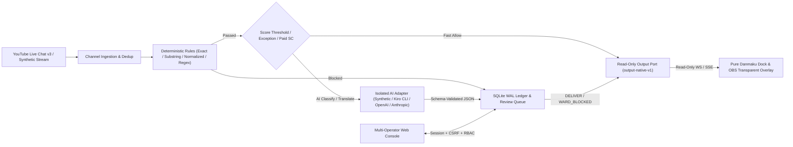

<div align="center">

# VoxWard

Cross-language livestream danmaku & chat moderation, channel-scoped trust scoring, and Super Chat translation middleware for VTuber broadcasts.

**English** · [简体中文](./README.zh-CN.md) · [日本語](./README.ja.md) · [한국어](./README.ko.md) · [Français](./README.fr.md)

[](https://github.com/tpmoonchefryan/Voxward/releases/tag/rc0.1.0)
[](./LICENSE)
[](./docs/KIROWEEN.md)

[Kiroween Judge Quickstart](#kiroween-2026-judge-quickstart) · [Architecture](#frankenstein-architecture) · [Core Capabilities](#core-capabilities) · [Self-Hosting](#self-hosted-deployment) · [Documentation Index](#documentation-index)

</div>

> [!NOTE]
> Built by **tpmoonchefryan** for **Kiroween 2026 (Frankenstein Track)** under **Apache-2.0**. The default experience ships in **Halloween theme + English (`en`)** with live 5-language switching (`English`, `简体中文`, `日本語`, `한국어`, `Français`).

---

## Why VoxWard

Live VTuber streams mix fast, noisy multilingual chat with high-value paid messages (Super Chats) that hosts need to read quickly and safely. Existing tools force hosts to pick between brittle keyword blacklists or heavyweight CRM bots.

VoxWard separates concerns cleanly into a self-hosted middleware:

- **Trusted fast path**: Deterministic matching (exact, substring, normalized, homophone hints, bounded regex) + channel-scoped SQLite WAL trust scores handle high-volume chat immediately.
- **Selective AI escalation**: Ambiguous chat and paid Super Chats route to isolated one-shot AI workers with temporary item IDs (`item-*`) and structured JSON schema validation — never exposing OAuth secrets or stable user IDs to prompts.
- **Read-only downstream displays**: Pure Danmaku Dock (`/dock/:channelId`) and transparent OBS Overlay (`/overlay/:channelId#cred=vwo_...`) receive strictly `ALLOW` / `WARD_BLOCKED` events with zero moderation buttons or internal scores.

---

## Kiroween 2026 Judge Quickstart

Reviewers can evaluate the complete frontend + backend pipeline in **zero-credential Sandbox mode** (no YouTube API key or LLM API key required). The launcher fails closed if real production secrets are present.

```bash
pnpm install --frozen-lockfile
pnpm build
node deploy/sandbox/start-sandbox.mjs
```

Open **`http://127.0.0.1:3100/sandbox`** in your browser:

1. Starts in **Halloween** theme + **English (`en`)** by default; use the top-right user menu to switch across **5 languages** (`en`, `zh-CN`, `ja`, `ko`, `fr`) and **3 themes** (`halloween`, `light`, `dark`).
2. Watch the **Live Stream Simulator** push continuous danmaku and timed Super Chat pills (or click **`+ Push SC Now`**).
3. Run the 6 preset scenarios and switch between **`Streamer View`**, **`Moderator View`**, **`Data Auditor`**, and **`Stage Visitor`** across the Moderation Desk, Pure Dock, OBS Stage Preview, Data Compliance Panel, and Snapshot Log views.

For full contest notes, see [Kiroween 2026 Submission Guide](./docs/KIROWEEN.md).

---

## Frankenstein Architecture



---

## Core Capabilities

| Area | Highlight | Key Paths |
| --- | --- | --- |
| **Multilingual & Themeable UI** | Halloween default on `/login`, `/sandbox`, and fresh accounts; live switching across `en`, `zh-CN`, `ja`, `ko`, `fr` backed by `/auth/shell-preferences` | [`apps/web/src/i18n/`](./apps/web/src/i18n/), [`VoxWardShell.tsx`](./apps/web/src/shell/VoxWardShell.tsx) |
| **Live Moderation & Queue** | Split-view review workbench, bulk verdicts, candidate keyword promotion, score rejudgement | [`ModerationPage.tsx`](./apps/web/src/pages/moderation/ModerationPage.tsx) |
| **Pure Dock & OBS Overlay** | Standalone clean chat + countdown Super Chat pills (`/dock/:channelId`) and `#cred=vwo_...` fragment-only OBS WebSocket stage (`/overlay/:channelId`) | [`DockPage.tsx`](./apps/web/src/pages/dock/DockPage.tsx), [`Stage.tsx`](./apps/web/src/pages/overlay/Stage.tsx), [`output-native-v1.md`](./docs/protocol/output-native-v1.md) |
| **Wordlists & CSV Workflows** | Append-only category dictionary, bounded regex validation, CSV template download + bulk import, scoring & retention controls | [`AdminPage.tsx`](./apps/web/src/pages/admin/AdminPage.tsx) |
| **Tri-State RBAC & Audit Chain** | `Deny > Grant > Not Set` multi-role permission synthesis, bidirectional technical/change/integration log trace with `<bdi>` isolation | [`UsersPage.tsx`](./apps/web/src/pages/users/UsersPage.tsx), [`LogViewer.tsx`](./apps/web/src/pages/logs/LogViewer.tsx) |
| **Data Compliance & Privacy** | Subject lookup, `DELETE_DATA_ONLY` / `DELETE_AND_EXCEPT` async cleanup registration, verification, and execution wiring | [`DataPanel.tsx`](./apps/web/src/pages/data/DataPanel.tsx) |

---

## Built with Kiro

This repository preserves its Kiro development artifacts in-tree:

- **Steering Rules**: [`.kiro/steering/`](./.kiro/steering/)
- **Incremental Specs & Acceptance Evidence**: [`.kiro/specs/`](./.kiro/specs/)
- **Local Skills & Harness Metadata**: [`.kiro/skills/mana-orchestrate/`](./.kiro/skills/mana-orchestrate/), [`.kiro/README.md`](./.kiro/README.md)

---

## Self-Hosted Deployment

Production deployment targets self-hosted Linux servers behind an HTTPS reverse proxy (such as Caddy) bound to loopback (`127.0.0.1:3000`) with strict `HttpOnly; Secure; SameSite=Strict` cookies and explicit one-time owner bootstrap.

- Quick template & bootstrap guide: [`deploy/server/README.md`](./deploy/server/README.md)
- Detailed remote deploy runbook: [`docs/deployment/remote-deploy.md`](./docs/deployment/remote-deploy.md)
- OBS & YouTube setup: [`docs/obs/setup.md`](./docs/obs/setup.md), [`docs/deployment/youtube-credentials.md`](./docs/deployment/youtube-credentials.md)

### Current Verification & External Boundaries

Local engineering checks verified at release candidate `rc0.1.0`: `pnpm check:deps`, `pnpm check:ds`, `pnpm typecheck`, `pnpm build`, `node scripts/deploy-check.mjs --env-file deploy/server/server.env.example`, `pnpm test -- --run` (187 test files, 2,019 tests), and Playwright E2E across all routes in Sandbox/LAN preview.

External dependencies explicitly left outside synthetic verification (see [`docs/deployment/troubleshooting-and-quotas.md`](./docs/deployment/troubleshooting-and-quotas.md) and [`deploy/kiro-runtime/README.md`](./deploy/kiro-runtime/README.md)):

- Live host execution of an isolated `kiro-cli` OS user (`VW-S029-KIRO-REAL`) and live AI provider latency/cost benchmarks (`VOXWARD-SUB-050`).
- Operator-owned Google Cloud OAuth verification and YouTube API quota/policy confirmation for channel-scoped scoring.

---

## Documentation Index

| Document | Scope | Languages |
| --- | --- | --- |
| [`docs/KIROWEEN.md`](./docs/KIROWEEN.md) | Kiroween 2026 Frankenstein pitch, walkthrough & Kiro mapping | English |
| [`SECURITY.md`](./SECURITY.md) | Supported versions, Private Vulnerability Reporting & trust boundaries | [EN](./SECURITY.md) · [zh-CN](./docs/i18n/zh-CN/SECURITY.md) · [JA](./docs/i18n/ja/SECURITY.md) · [KO](./docs/i18n/ko/SECURITY.md) · [FR](./docs/i18n/fr/SECURITY.md) |
| [`PRIVACY.md`](./PRIVACY.md) | Self-hosted data flow, AI minimization & platform copy boundaries | [EN](./PRIVACY.md) · [zh-CN](./docs/i18n/zh-CN/PRIVACY.md) · [JA](./docs/i18n/ja/PRIVACY.md) · [KO](./docs/i18n/ko/PRIVACY.md) · [FR](./docs/i18n/fr/PRIVACY.md) |
| [`CONTRIBUTING.md`](./CONTRIBUTING.md) | Local workflow, DS/deps gates & five-language sync rules | [EN](./CONTRIBUTING.md) · [zh-CN](./docs/i18n/zh-CN/CONTRIBUTING.md) · [JA](./docs/i18n/ja/CONTRIBUTING.md) · [KO](./docs/i18n/ko/CONTRIBUTING.md) · [FR](./docs/i18n/fr/CONTRIBUTING.md) |
| [`CODE_OF_CONDUCT.md`](./CODE_OF_CONDUCT.md) | Community standards & confidential reporting | [EN](./CODE_OF_CONDUCT.md) · [zh-CN](./docs/i18n/zh-CN/CODE_OF_CONDUCT.md) · [JA](./docs/i18n/ja/CODE_OF_CONDUCT.md) · [KO](./docs/i18n/ko/CODE_OF_CONDUCT.md) · [FR](./docs/i18n/fr/CODE_OF_CONDUCT.md) |
| [`CHANGELOG.md`](./CHANGELOG.md) | Release history (`rc0.1.0`) | English |
| [`LICENSE`](./LICENSE) & [`NOTICE`](./NOTICE) | Apache-2.0 license, third-party & bundled SIL OFL 1.1 font notices | English (authoritative) |
