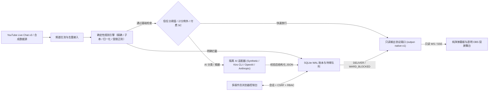

> 说明：本文档以[英文原版](./README.md)为准 · `synced-to: 457d240e8b0837101b230a1a54ac606b7500ddc3c4766c964c43a1e533c66360`

<div align="center">

# VoxWard

面向跨语种 VTuber 直播的弹幕审核、频道内信任计分与 Super Chat 精翻中间件。

[English](./README.md) · **简体中文** · [日本語](./README.ja.md) · [한국어](./README.ko.md) · [Français](./README.fr.md)

[](https://github.com/tpmoonchefryan/Voxward/releases/tag/rc0.1.0)
[](./LICENSE)
[](./docs/KIROWEEN.md)

[评委零配置速览](#kiroween-2026-评委速览) · [系统架构](#frankenstein-架构) · [核心能力](#核心能力) · [自托管部署](#自托管部署) · [文档导航](#文档导航)

</div>

> [!NOTE]
> 由 **tpmoonchefryan** 基于 **Apache-2.0** 为 **Kiroween 2026（Frankenstein 赛道）** 构建。默认首屏为 **万圣节（Halloween）主题 + 英文（`en`）**，支持在界面中实时切换 **五种语言**（`English`、`简体中文`、`日本語`、`한국어`、`Français`）。

---

## 为什么做 VoxWard

跨语种 VTuber 直播需要同时应付高频日常弹幕与高价值的付费醒目留言（Super Chat），既要低延迟放行安全互动，又要拦住骚扰与合规风险。现有工具往往只能在简陋的关键词黑名单或重型 CRM 机器人之间二选一。

VoxWard 将职责拆解为自托管中间件的协同流水线：

- **可信快车道**：确定性规则（精确、子串、归一化、跨语种同音提示、受限正则）配合频道内 SQLite WAL 信任分账本，毫秒级处理普通互动。
- **按需 AI 升级**：边界消息与付费 Super Chat 路由至隔离的一次性 AI 任务，仅发送临时编号（`item-*`）与结构化 JSON 校验契约，绝不向模型暴露 OAuth 密钥或稳定平台用户 ID。
- **只读下游呈现**：纯净弹幕姬（`/dock/:channelId`）与透明 OBS 投屏舞台（`/overlay/:channelId#cred=vwo_...`）只接收 `ALLOW` / `WARD_BLOCKED` 帧，不含内部评分、审核按钮或敏感原文泄露。

---

## Kiroween 2026 评委速览

评审无需准备 Google Cloud 凭据、YouTube OAuth 令牌或外部 LLM API Key，可直接启动**零密钥合成演示沙盒**（若环境变量中误配真实密钥，沙盒守卫会自动 fail-closed 拒绝启动）：

```bash
pnpm install --frozen-lockfile
pnpm build
node deploy/sandbox/start-sandbox.mjs
```

随后在浏览器打开 **`http://127.0.0.1:3100/sandbox`**：

1. 默认进入 **Halloween 主题 + 英文（`en`）**；可通过右上角用户头像菜单实时切换 **五国语言**（`en`、`zh-CN`、`ja`、`ko`、`fr`）与 **三种主题**（`halloween`、`light`、`dark`）。
2. 观察顶部的**实时弹幕流模拟器**：持续推送普通弹幕与带倒计时进度条的置顶/信息流 Super Chat 卡片（可调频或点击 **`+ Push SC Now`** 手动插播）。
3. 依次触发 6 个预设场景，并在 **`Streamer View`、`Moderator View`、`Data Auditor`、`Stage Visitor`** 四个演示角色间切换，检验真实工作台组件与服务端权限隔离。

详细参赛说明见 [Kiroween 2026 提交说明](./docs/KIROWEEN.md)。

---

## Frankenstein 架构



---

## 核心能力

| 模块 | 核心特性 | 主要源码入口 |
| --- | --- | --- |
| **五语与多主题界面** | `/login`、`/sandbox` 与新账号默认 `halloween` + `en`；支持 5 语实时切换与 `/auth/shell-preferences` 持久化 | [`apps/web/src/i18n/`](./apps/web/src/i18n/), [`VoxWardShell.tsx`](./apps/web/src/shell/VoxWardShell.tsx) |
| **实时审核工作台** | 分栏工作台、批量裁决、AI 候选词确认入库、关联积分重判 | [`ModerationPage.tsx`](./apps/web/src/pages/moderation/ModerationPage.tsx) |
| **纯净弹幕姬与 OBS 舞台** | 独立极简弹幕/SC 流（`/dock/:channelId`）与仅通过 Hash `#cred=vwo_...` 鉴权的 OBS 舞台（`/overlay/:channelId`） | [`DockPage.tsx`](./apps/web/src/pages/dock/DockPage.tsx), [`Stage.tsx`](./apps/web/src/pages/overlay/Stage.tsx), [`output-native-v1.md`](./docs/protocol/output-native-v1.md) |
| **词库、CSV 与系统设置** | 只增不删分类字典、受限正则校验、CSV 模板下载与批量导入、计分与保留周期策略 | [`AdminPage.tsx`](./apps/web/src/pages/admin/AdminPage.tsx) |
| **三态 RBAC 与关联日志** | `Deny > Grant > Not Set` 权限合成预览；技术/变更/集成日志联合追踪与 `<bdi>` 隔离展示 | [`UsersPage.tsx`](./apps/web/src/pages/users/UsersPage.tsx), [`LogViewer.tsx`](./apps/web/src/pages/logs/LogViewer.tsx) |
| **数据合规与遗忘权闭环** | 主体档案检索、`DELETE_DATA_ONLY` 与 `DELETE_AND_EXCEPT` 请求登记、核验及异步清理执行 | [`DataPanel.tsx`](./apps/web/src/pages/data/DataPanel.tsx) |

---

## Built with Kiro

仓库完整保留开发阶段的 Kiro 工程产物：

- **Steering 规范**：[`.kiro/steering/`](./.kiro/steering/)
- **分步 Specs 与验收记录**：[`.kiro/specs/`](./.kiro/specs/)
- **项目级 Skill 与本地 Hook 架构**：[`.kiro/skills/mana-orchestrate/`](./.kiro/skills/mana-orchestrate/), [`.kiro/README.md`](./.kiro/README.md)

---

## 自托管部署

生产部署面向主播或运维托管的 Linux 服务器：后端绑定本机回环端口（`127.0.0.1:3000`），前置 HTTPS 反向代理（如 Caddy），启用 `HttpOnly; Secure; SameSite=Strict` 会话 Cookie，并通过一次性 CLI 引导初始化首位所有者账号。

- 部署模板与引导命令：[`deploy/server/README.md`](./deploy/server/README.md)
- 完整远端自托管手册：[`docs/deployment/remote-deploy.md`](./docs/deployment/remote-deploy.md)
- OBS 与 YouTube OAuth 配置：[`docs/obs/setup.md`](./docs/obs/setup.md), [`docs/deployment/youtube-credentials.md`](./docs/deployment/youtube-credentials.md)

### 已验证范围与外部未验证边界

预发布版本 `rc0.1.0` 已在本地完成 `pnpm check:deps`、`pnpm check:ds`、`pnpm typecheck`、`pnpm build`、`node scripts/deploy-check.mjs --env-file deploy/server/server.env.example`、`pnpm test -- --run`（187 组测试文件、2,019 项测试全过）及 Playwright 全链路 E2E 验证。

仍属外部部署前提、未在合成环境下伪造实测结果的边界（详见 [`docs/deployment/troubleshooting-and-quotas.md`](./docs/deployment/troubleshooting-and-quotas.md) 与 [`deploy/kiro-runtime/README.md`](./deploy/kiro-runtime/README.md)）：

- 真实独立 Linux 运行账号下的 `kiro-cli` 调用实测（`VW-S029-KIRO-REAL`）与真实模型延迟/费用基准（`VOXWARD-SUB-050`）。
- 部署方独立 Google Cloud 项目 OAuth 审核及 YouTube API 配额与频道计分用途合规确认。

---

## 文档导航

| 文档 | 内容范围 | 支持语言 |
| --- | --- | --- |
| [`docs/KIROWEEN.md`](./docs/KIROWEEN.md) | Kiroween 2026 参赛说明、架构拼接与 Kiro 清单 | English |
| [`SECURITY.md`](./SECURITY.md) | 支持版本、GitHub 私密漏洞披露与安全边界 | [EN](./SECURITY.md) · [zh-CN](./docs/i18n/zh-CN/SECURITY.md) · [JA](./docs/i18n/ja/SECURITY.md) · [KO](./docs/i18n/ko/SECURITY.md) · [FR](./docs/i18n/fr/SECURITY.md) |
| [`PRIVACY.md`](./PRIVACY.md) | 自托管数据流、AI 最小化传入与平台原始副本边界 | [EN](./PRIVACY.md) · [zh-CN](./docs/i18n/zh-CN/PRIVACY.md) · [JA](./docs/i18n/ja/PRIVACY.md) · [KO](./docs/i18n/ko/PRIVACY.md) · [FR](./docs/i18n/fr/PRIVACY.md) |
| [`CONTRIBUTING.md`](./CONTRIBUTING.md) | 环境要求、校验门禁、开发约定与五语文档同步规范 | [EN](./CONTRIBUTING.md) · [zh-CN](./docs/i18n/zh-CN/CONTRIBUTING.md) · [JA](./docs/i18n/ja/CONTRIBUTING.md) · [KO](./docs/i18n/ko/CONTRIBUTING.md) · [FR](./docs/i18n/fr/CONTRIBUTING.md) |
| [`CODE_OF_CONDUCT.md`](./CODE_OF_CONDUCT.md) | 社区行为准则与私密投诉通道 | [EN](./CODE_OF_CONDUCT.md) · [zh-CN](./docs/i18n/zh-CN/CODE_OF_CONDUCT.md) · [JA](./docs/i18n/ja/CODE_OF_CONDUCT.md) · [KO](./docs/i18n/ko/CODE_OF_CONDUCT.md) · [FR](./docs/i18n/fr/CODE_OF_CONDUCT.md) |
| [`CHANGELOG.md`](./CHANGELOG.md) | 版本变更日志（`rc0.1.0`） | English |
| [`LICENSE`](./LICENSE) & [`NOTICE`](./NOTICE) | Apache-2.0 许可证、第三方包与 SIL OFL 1.1 字体声明 | English (authoritative) |
