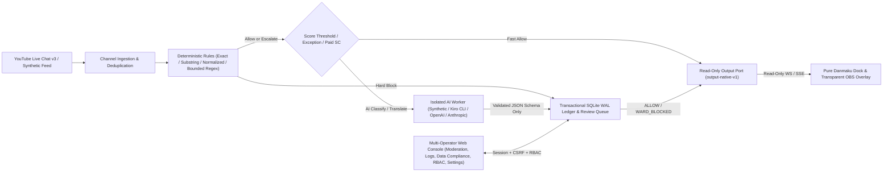

# VoxWard — Kiroween 2026 Submission Guide

> Track: **Frankenstein** · Entry Type: **Solo (`tpmoonchefryan`)** · License: **Apache-2.0**

VoxWard is a self-hosted livestream danmaku/chat moderation, channel-scoped trust-scoring, and paid-message (Super Chat) translation middleware built for cross-language VTuber broadcasts.

It stitches traditionally separate pieces — live chat ingestion, deterministic content rules, a transactional SQLite trust-score ledger, untrusted-text-isolated AI moderation/translation workers, browser RBAC moderation desks, and read-only OBS / desktop downstream overlays — into a single coherent real-time pipeline.

## 1. Zero-Credential Judge Quickstart (`/sandbox`)

> **Live Online Sandbox (Zero Setup)**: Judges can evaluate VoxWard immediately at **[https://voxward.tcrn-platform.com/sandbox](https://voxward.tcrn-platform.com/sandbox)** with no local build, Google Cloud credentials, or API keys required.

To run the same zero-credential synthetic sandbox locally:

```bash
pnpm install --frozen-lockfile
pnpm build
node deploy/sandbox/start-sandbox.mjs
```

Then open **`http://127.0.0.1:3100/sandbox`** in your browser.

What to try in the 3-minute walkthrough:

1. **Seasonal Theme & 5-Language Switching**: Opens in **Halloween + English (`en`)** by default. Open the top-right user menu (`?`) to switch seamlessly among `English`, `简体中文`, `日本語`, `한국어`, and `Français`, or compare **Halloween**, **Light**, and **Dark** themes.
2. **Live Danmaku & Super Chat Stream Simulator**: Start/pause chat flow, adjust cadence (`Calm` / `Standard` / `Lively`) and SC intervals, or click **`+ Push SC Now`** to watch pinned top Super Chat countdown timers, bottom-up inline SC cards, and clean pure-dock output.
3. **4-Role Demo RBAC & 6 Preset Scenarios**:
   - Trigger `Normal Chat Scoring`, `Spam & Toxicity Block`, `SC Translation & Tiers`, `Queue Manual Review`, `Delete Data Request`, and `Delete & Score Exception`.
   - Switch between **`Streamer View`**, **`Moderator View`**, **`Data Auditor`**, and **`Stage Visitor`** to observe fail-closed server permission boundaries across the Moderation Desk, Pure Dock, OBS Stage, Data Compliance panel, and Snapshot Log views.

## 2. Frankenstein Architecture



Key stitched boundaries:

- **Downstream Read-Only Purity**: Pure Dock (`/dock/:channelId`) and OBS Overlay (`/overlay/:channelId#cred=vwo_...`) receive only `HELLO`, `DELIVER`, and retraction `WARD_BLOCKED` frames — zero internal trust scores, moderation action buttons, raw user IDs, or management chrome.
- **Untrusted Viewer Text Isolation**: Viewer messages sent to AI use temporary per-task item IDs (never stable YouTube user IDs or OAuth tokens), and web audit logs isolate bidirectional control characters inside `<bdi>` wrappers.
- **Explicit Async Deletion + Scoring Exception**: `DELETE_AND_EXCEPT` enrolls a minimal channel-scoped preference marker so opted-out viewers are never scored again, while transparently clarifying that local deletion does not remove YouTube platform copies.

## 3. How Kiro Powered Development

| Kiro Capability | Repository Location | Role in VoxWard |
| --- | --- | --- |
| **Steering** | [`.kiro/steering/`](../.kiro/steering/) | Nine concise project rules governing design-authority reuse, autonomy, batch execution, unattended commands, and residue cleanup. |
| **Specs** | [`.kiro/specs/`](../.kiro/specs/) | Incremental specification suite (`voxward-core-contracts`, `voxward-s001`–`s033`, `voxward-init004`–`007`, `voxward-batch*`, `voxward-frontend-v2`) tracking contracts, evidence, and acceptance gates. |
| **Skills & Local Harness** | [`.kiro/skills/mana-orchestrate/`](../.kiro/skills/mana-orchestrate/), [`.kiro/harness/`](../.kiro/harness/), [`.kiro/README.md`](../.kiro/README.md) | Project-local orchestration skill and `.kiro` harness setup for spec/memory continuity. |
| **Hooks** | [`.kiro/hooks/einzbern.json`](../.kiro/hooks/einzbern.json) | Workspace hook configuration schema (`v1`, cleanly decoupled with zero external credential leakage). |

## 4. Verification Highlights & Demo Video

- **3-Provider Live AI Benchmark ([`ai-quality-latency-cleanup-report.md`](acceptance/ai-quality-latency-cleanup-report.md))**: Measured across 81 synthetic multi-language samples with `moderation-engine` prefilter (`81/81`) and `openai-compat` (`gpt-4.1-mini`, P50 `2.45s`), `anthropic-compat` (`claude-haiku-4-5-20251001`, P50 `1.95s` with fail-closed `502` handling), and headless `kiro-cli 3.6.0` (P50 `13.20s`), recording zero `ENUM_INVALID` contract violations and verified orphan session sweep.
- **Security Hardening & Immutable Supply Chain**: Enforced per-route Fastify rate limits, RBAC delegation ceilings, `VOXWARD_SECRETS_KEY` vault fail-closed protection, DNS-rechecked SSRF guards (`safeOutboundFetch`), WS upgrade/delivery isolation, and `@sha256:` image digests (`node scripts/deploy-check.mjs`).
- **Browser-to-OBS E2E Matrix ([`mvp-e2e-matrix.md`](acceptance/mvp-e2e-matrix.md))**: Verified full pipeline from clean volume bootstrap and RBAC moderation through WebSocket delivery (`native-v1` / `blivechat`), Overlay `#cred=` cleanup & bidi isolation, to `DELETE_AND_EXCEPT` tombstone persistence across backup restore.
- **Demo Video (< 3 min) ([`kiroween-demo-video-verification.md`](kiroween-demo-video-verification.md))**: `voxward-kiroween-demo-2k.mp4` (`136.51s`, `2560x1440` `avc1` + `mp4a`, synthetic sandbox only, zero secrets/PII).

## 5. Honest Scope Boundaries (Local Pack Ready vs Owner Submission Actions)

- **Main Track Only**: Submitted strictly for the **Frankenstein** main track with no bonus category claims.
- **Owner-Gated External Actions Pending**: Live YouTube OAuth project/compliance forms, public repo publication & Devpost submission receipt, production container image digest push, and host-level `useradd voxward-kiro` OS provisioning require direct execution by the project Owner.
- **AI Provider Retention Boundary**: Application-side deletion of temporary run directories and local sessions does not constitute a third-party provider zero-retention guarantee.
