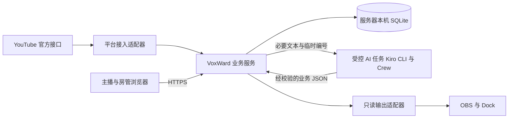

# 数据处理说明（草案）

状态：草案，供 Owner 审核，未对外发布。

边界：本文描述提案的设计目标。它不代表功能已经实现、性能已经实测或平台已经批准。文中的保留期限是提案的初始建议，不是已确认的平台要求。

来源：`docs/proposal/y3_project_proposal.md`（2026-11-09 对话决策整合版）。具体章节见各节开头的括号。

## 1. 数据流与拓扑

消息从 YouTube 官方接口进入，经服务端处理后，只把获准的展示事件输出到直播展示工具。业务数据保存在服务器本机卷上的 SQLite 中，所有写入经单个后端完成（提案第 2.2、10 节）。模块按提案第 9.3 节的版本化契约划分，保持远端自托管和既定技术栈（pnpm、TypeScript、Fastify、SQLite WAL、Drizzle ORM、React、Vite）。MVP 不提供官方生产托管，也不新开发本机代理（第 1.1、10、13.2 节）。

| 环节 | 传出或写入的数据 | 不传出的数据 | 提案来源 |
| --- | --- | --- | --- |
| 平台接入 | 从 YouTube 接收消息事件。保存内部事件引用、去重依据、身份能力及其来源、游标。消息 ID 用于去重 | 除凭据和接口参数外，不向平台发送观众数据。只有明确执行的删除操作，且部署已配置相应凭据、授权账号具备权限时，才调用平台删除接口 | 第 3.1、3.2、7.3 节 |
| 业务服务 | 写入 SQLite：频道与权限、主体与评分、规则与名单、消息与任务状态、两类日志、数据请求 | 不把完整正文复制到队列、Crew 或额外日志 | 第 8.4、10 节 |
| AI 任务 | 发送任务说明、规则摘要、临时 `itemId`、必要消息正文，以及有限上下文。跨条分析使用任务内的临时别名 | 平台用户 ID、稳定昵称索引、账号令牌、评分账本、服务器密钥 | 第 8.1 节 |
| AI 结果回传 | 经结构校验的业务 JSON | 未经校验的原始输出、思维链、完整对话 | 第 8.2、8.3 节 |
| 下游输出 | 获准展示事件：显示昵称或安全称呼、文本、付费展示信息、翻译和投递标识。拦截事件不含原文和用户身份 | 稳定平台用户 ID、内部评分、名单、完整审核理由、提示词、模型对话 | 第 13.1 节 |
| 管理页面 | 主播与房管通过 HTTPS 访问。服务端按频道和角色逐次校验 | 浏览器不直接写数据库（第 1.1 节）。AI 任务只由业务服务通过受控接口发起（第 2.2 节） | 第 1.1、2.1、2.2、10 节 |

处理顺序（第 4.2 节）：去重和频道范围登记，然后黑名单与统一基础检查，然后记分例外判断，然后付费文本安全审核，然后普通消息的快速分流或 AI 审核，最后提交结果。白名单仍需经过基础检查。高分和白名单不取消付费文本的安全审核。

保护范围（第 4.4 节）：VoxWard 保护的是经它输出的内容。原生聊天室、直接订阅平台的工具、绕过中间件的朗读链路，不受 VoxWard 的本地拦截影响。已放行的内容不能保证撤回。

## 2. 角色与授权

依据提案第 2.1 节。服务端对每个 HTTP 请求、WebSocket 订阅、批量操作和后台任务校验频道与角色。频道范围由可信会话和任务记录确定，不只信任客户端提交的 `roomId`。

| 角色 | 主要权限 | 约束 |
| --- | --- | --- |
| 部署管理员 | 服务配置、凭据、备份恢复、日志管理与升级 | 服务器管理身份不自动等同于所有频道的内容管理角色 |
| 主播或频道所有者 | 管理所属频道、邀请房管、评分规则、模型和输出端配置 | 平台账号授权与 VoxWard 页面登录分别管理 |
| 房管 | 所授权频道的实时队列、人工放行或拦截、获准的名单与词条操作。按单独授予的日志权限使用查看器 | 默认不获得 OAuth 密钥、历史消息证据或其他频道数据 |
| 数据管理员 | 接收和核验观众数据请求，执行删除及记分例外操作 | 由主播明确授予，可由主播本人兼任，不自动授予所有房管 |
| 下游消费者 | 订阅一个房间的获准输出及无原文的拦截事件 | 使用可撤销的只读凭据，不能上传弹幕、修改评分或读取审核后台 |

## 3. 评分公式与计分规则

依据提案第 5、15.1 节。

- 评分键：平台、主播频道和频道内观众主体。评分只在该频道内用于审核分流，不公开，不跨频道，不形成跨频道画像。
- 公式：`nextScore = clamp(currentScore + requestedDelta, minScore, maxScore)`，`actualDelta = nextScore - currentScore`。实际更新由服务端完成。
- 配置项：评分开关、最低分、最高分、快速通道阈值、身份基础分、合规加分、违规扣分、加分冷却时间。

| 结果或事件 | 计分行为 |
| --- | --- |
| 有意义的正常消息 | 按规则加分，受同一主体的加分冷却限制 |
| 无意义互动（噪声） | 不加分，不扣分 |
| 内容规则或模型确认拦截 | 按适用规则扣分，同一裁决不重复扣分 |
| AI 超时、限流、输出不合法或内部错误 | 不因系统故障扣观众分数 |
| 达到上下限 | 按实际生效值记账，被钳制的部分不记为已生效变化 |
| 记分例外名单 | 不建立或更新有效评分，不执行实时计分、复盘、身份奖励或人工调分 |

模型只能提供内容分类和有限证据，不能输出任意分数、任意 `delta`，也不能直接更新数据库（第 5.1 节）。

人工纠错（第 7.1 节）：纠正计分时依据原账本记录的实际生效变化，而不是机械加回配置中的扣分值。受影响的部分在保留的账本范围内重算，并以可追溯的补偿记录提交。超出可重建范围的，走明确的人工调整。系统不声称已精确恢复历史。

身份基础分由平台适配器提供的已验证身份能力决定。真实会员升级可以触发配置的基础分差额，但必须依据幂等事件或有效身份变化，只应用一次（第 5.2 节）。身份降级、到期和基础分变化的语义需要明确配置。

昵称检查缓存的键至少包含内部主体、显示昵称哈希、规则版本和有效期。缓存只能减少重复的昵称检查，不能跳过正文与昵称组合的检查，也不能声明某用户永久安全（第 5.3 节）。

快速通道的消息标记为待复盘，当次不直接获得合规加分。后台复盘结果仍经过同一业务校验和计分引擎。候选关键词只能形成待确认卡片，经有权限的人员确认后才进入规则库（第 5.4 节）。

## 4. 保留与刷新期限

下表是提案第 12.3 节的初始实现建议。建议值不是平台要求，未经平台确认。

| 数据 | 提案的初始建议 | 状态 |
| --- | --- | --- |
| 实时队列与短期上下文 | 只保留到任务结束或截止。因复核需要保存的最小证据，进入 Technical Log 的受控内容 | 提案建议 |
| 完整 AI 会话 | 结束、失败或取消后即清理。恢复时清理异常残留，不设长期归档库 | 已实现，且已在 `kiro-cli 3.6.0` 隔离 `0700` 目录完成正常、超时、取消与带 `sessionId` 崩溃孤儿清理实测（不含提供方零留存保证） |
| Technical Log 中的原文、原始弹幕 ID 映射、翻译和校验后 JSON | 初始建议最多 7 天，可缩短。删除请求与用途终止优先于定时到期 | 数值待确认 |
| Change Log 与 Technical Log 中不含原文的变更和运行元数据 | 初始建议 30 天，可缩短。可关联到用户的条目和关联索引仍纳入数据请求 | 数值待确认 |
| 评分状态、身份缓存和计分账本 | 设明确期限，以及刷新或到期行为。真实 YouTube 评分的允许用途和保存期限待平台确认，不能默认无限保留 | 未确认 |
| 记分例外标记 | 只为持续执行用户偏好而保留最小记录，并说明目的和删除、恢复机制 | 提案设计 |
| 备份 | 有界轮换，设权限和删除恢复规则。不能成为无限保留原文或画像的旁路 | 提案设计，实现未验证 |

开发者政策的核对结果（III.E.4 与 III.D.2.c 依据全文，页面 Last updated 2026-11-06 UTC；派生指标条款依据片段，见 `status-and-gaps.md` 第 5 节）：

- 一般授权数据（III.E.4.c）：除 III.E.4.b 所列统计类数据外，最多保存 30 个日历日，到期须删除或刷新。
- 统计类授权数据（III.E.4.b，包括 Analytics 数据、Reporting 数据及其他 API 提供的统计数字）：可在与用户授权用途相符的前提下保存更久，但每 30 日须确认用户仍授权访问。
- 非授权数据（III.E.4.b、III.E.4.d）：最多保存 30 个日历日，到期须删除或刷新。
- 获准派生指标用途后，统计数据和派生指标可保存至 36 个日历月。该条件仅适用于经审核、通过标准配额扩展申请明确申请许可的分析用例，自 2026-06-01 起（III.L）。36 个月的数值来自派生指标补充条款页，仅依据片段核对。标题、名称、评论正文等数据仍按 30 天刷新或删除规则处理。
- 本包不把 36 个月条款套用于全部聊天日志，也不在尚未获准时据此保留观众评分（提案第 12.3 节）。

## 5. 删除与记分例外

依据提案第 7.3、11、12.4 节。

### 5.1 两种删除选项

| 删除选项 | 历史数据 | 后续消息与计分 |
| --- | --- | --- |
| 仅删除数据 | 按请求范围清理现有数据 | 不新增，也不自动撤销记分例外。后续处理遵循有效授权、现有偏好和频道规则 |
| 删除并加入记分例外名单 | 清理同样范围的数据，并保留执行该偏好所需的最小标记 | 不再计分。每条新消息进入审核流程，不享有快速通道 |

组合选项是一项可追踪的请求，不要求操作者删除后再手动添加名单。先在同一事务内建立或确认例外标记，使旧任务代次失效，登记删除任务，再执行清理。重复执行不产生重复名单项。只有删除和例外状态都完成，才显示成功。部分失败保留明确状态，可以继续处理。

### 5.2 删除范围

删除任务先阻止相关旧任务继续产生结果，再清理以下对象：评分、账本、缓存、两类日志中的适用数据、Technical Log 中的消息证据和结构化 AI 结果、待执行任务、本地 AI 会话、索引（包括昵称变更、任务临时 ID 和关联日志条目）。WAL、临时文件、备份和 AI 运行目录也在清理与验证范围内，恢复任务时不能复活已删除的数据（第 12.4 节）。删除任务优先阻止继续读取、输出和落库，不等待普通复盘队列排空（第 6.2 节）。

已发出的模型请求在支持时取消。无法取消的晚到结果直接丢弃。历史任务重试、Crew 重启恢复或数据库备份恢复，都不能重新创建已删除的画像。删除后，Change Log 保留不含消息正文和历史分数的最小处理凭证。

删除 VoxWard 中的数据，不等于删除 YouTube 上的原始内容（第 11.3 节）。第三方模型提供方的留存需要单独说明，本地清理成功不能代替提供方删除证明（第 12.4 节）。

### 5.3 删除时限与撤销授权

提案第 11.3 节写明，产品应把内部执行目标设为尽快完成，不能把七天当作固定等待期。该节的七个日历日与 III.E.4.g 一致，适用于用户请求删除存储数据的情形。

开发者政策的期限（依据全文，页面 Last updated 2026-11-06 UTC）：

| 条款 | 情形 | 期限 |
| --- | --- | --- |
| III.E.4.g | 用户请求删除 API Client 存储的相关数据，包括在该 Client 中删除账号 | 尽快删除，且不迟于 7 个日历日 |
| III.D.2.c.i | 用户经应用内的撤销机制撤销授权 | 尽快删除，且不迟于撤销后 7 个日历日 |
| III.D.2.c.ii | 用户经 Google 安全设置页撤销授权 | 尽快删除，且不迟于撤销后 30 个日历日 |
| III.E.4.c、III.E.4.d | 一般授权数据与非授权数据的存储期限（统计类数据见 III.E.4.b） | 最多保存 30 个日历日，到期删除或刷新 |

III.E.4.g 要求删除方法须写明：删除 API Client 中的数据，不影响 YouTube 上的数据。要删除 YouTube 上的数据，用户需使用 YouTube 应用或支持删除的授权 API Client。

- “用户”是否包括发言观众，政策原文未直接说明。该问题列为待平台确认（见 `platform-questions.md` 的 Q3），不改变 7 日期限本身。
- III.D.2.c 要求提供清楚、易用的撤销方式。撤销授权的入口在提案中没有列出，实现状态未确认。

### 5.4 记分例外名单

依据提案第 11.4 节。

| 属性 | 行为 |
| --- | --- |
| 范围 | 单个平台、单个主播频道 |
| 记分 | 不建立或更新有效评分。身份奖励、实时审核、后台复盘和人工调分都不得绕过 |
| 审核 | 每条消息进入审核流程。基础检查明确拒绝的可以结束，其余进入 AI 或人工路径 |
| 快速通道 | 不享有积分免审，白名单和无意义互动规则也不能绕过例外 |
| 历史删除 | 删除已有评分、相关证据和派生结果，不是隐藏原评分 |
| 恢复计分 | 需要明确的恢复请求。名单同步、重连或普通房管改分都不会自动退出 |

为了在该账号再次发言时识别偏好，建议保存频道范围的 HMAC 主体标记、偏好类型、建立时间和必要的请求依据。不保存旧分数和昵称历史。密钥只保存在服务器。HMAC 标记仍属于可关联的假名化数据，不能宣传为匿名数据。

## 6. 外部 AI 披露

依据提案第 8、9.2、16 节。

- 发送的内容：任务说明、规则摘要、临时 `itemId`、必要消息正文，以及完成任务所需的有限上下文。跨条分析时使用本任务内的随机别名。
- 不发送的内容：平台用户 ID、稳定昵称索引、账号令牌、观众分数账本、服务器密钥。平台昵称、用户 ID、主页地址和头像默认不传给外部模型。
- 临时 ID 是假名化措施，不能证明正文匿名。观众可能在正文中透露姓名或其他信息。发送前应移除不必要的身份字段。
- 消息内容中的命令或“忽略规则”之类文本，只作为待审数据，不作为宿主指令（第 16 节）。
- 结构化输出：AI 只返回约定的业务结构。服务端校验 JSON 格式、字段、枚举、长度、`itemId` 对应关系等，然后才采纳结果。
- 保存情况（第 8.4 节）：

| 对象 | 处理方式 |
| --- | --- |
| 校验后的分类 JSON 和必要翻译结果 | 进入 Technical Log 的受控内容，遵循保留和删除期限 |
| 模型名、提供方、规则或提示模板版本、延迟、错误类型 | 由服务端写入 Technical Log 元数据 |
| 完整提示词实例、完整上下文、对话全文、思维链、原始工具轨迹 | 不作为长期日志保存，调试时也不转储 |
| 模型会话和本地运行临时文件 | 任务结束后清理 |

- 提供方留存：VoxWard 不长期保存完整 AI 对话，这是应用侧的承诺。它不等于 Kiro、模型提供方或底层云服务零留存。提供方的留存、训练选择和可删除能力取决于产品与套餐。部署页面应展示实际政策，不能把训练退出选项写成零留存保证（第 8.4 节）。提案引用 Kiro 的会话管理与数据保护文档，本包未核对。
- Archive、导出或移入可恢复的回收区，不等于删除。部署时需要验证所用版本的实际清理行为（第 8.4 节）。

披露文字草稿（待 Owner 确认，未核对提供方条款）：

> 直播弹幕或付费留言中的文字，可能在审核或翻译时发送给所选的 AI 服务处理。发送内容不包含观众的平台账号标识，但文字本身可能包含个人信息。VoxWard 不长期保存完整的 AI 对话。AI 服务提供方的留存和训练选项，以其实际条款为准。

## 7. 下游输出范围

依据提案第 13.1、14 节。

- 输出字段：显示昵称或安全称呼、文本、付费展示信息、翻译及投递标识。
- 不输出：稳定平台用户 ID、内部评分、名单、完整审核理由、提示词、模型对话。
- 被拦截的消息只产生不含原文和用户身份的拦截事件，用于舞台动画。管理界面中的拦截复核列表不是对下游广播违规文本的通道。
- 同一份裁决适用于所有下游。接收方可以按自己的设置朗读获准文本。VoxWard 不提供 TTS，不实现语音裁决。
- 下游使用可撤销的只读凭据，不能读取管理页面。
- 平台内容应标注来源。评分等产品判断不标注为 YouTube 官方结论。
- 输出对象与用途的限制，见 `platform-questions.md` 的 Q5。
- 过期消息不自动补播。人工放行旧消息时显示消息年龄，补发必须是明确操作，并受输出有效期限制。恢复连接时，不能自动重播过时的付费卡片或朗读旧消息（第 6.3 节）。
