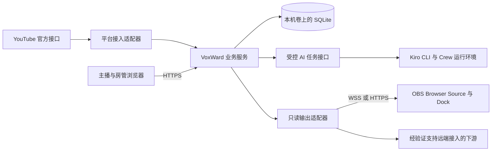
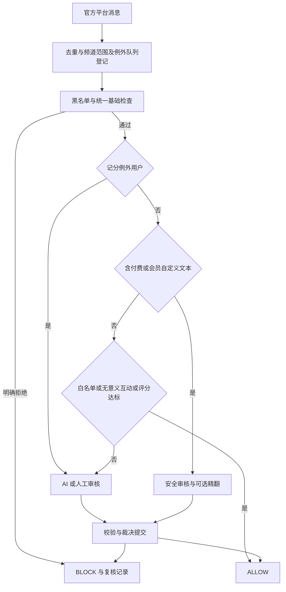

# VoxWard 项目提案与 MVP 规格

版本：2026-11-08 · 对话决策整合版  
项目：Kiroween 2026 · 主赛道目标：Frankenstein  
文档状态：产品与架构提案，可据此拆分 Kiro Specs；不代表功能已经实现、性能已经实测或平台已经批准。

## 1. 项目概述

VoxWard 是面向跨语种 VTuber 直播的弹幕审核、频道内评分与付费消息精翻中间件。它直接从直播平台的官方接口获取消息，在主播自行部署的服务器上完成基础检查、审核分流、AI 判断和人工复核，再把获准内容发送给直播展示工具。

核心价值是兼顾直播实时性与内容安全：普通消息在统一基础检查后，依据频道内评分等明确规则分流；需要进一步判断的消息进入 AI 或人工审核；Super Chat 等付费文本获得安全审核、翻译和答谢小抄。评分是本项目的核心机制，保留完整设计与实现目标。YouTube 是否允许这一具体用途，是仍需外部确认的准入事项。

VoxWard 定位为 Middleware。它保留运行功能所必需的频道内状态，不建设跨主播、跨平台的观众信誉网络，也不把成为 CRM 作为既定发展方向。未来需要客户关系管理能力时，优先与真正的 CRM 集成，并单独确认数据用途与授权。

### 1.1 本版确定的产品边界

| 主题 | MVP 决策 |
| --- | --- |
| 部署 | 主播或其受托运维自行部署；默认考虑远端服务器，不假定运行在主播电脑上；短期不提供官方托管生产服务 |
| 访问方式 | 主播与多名房管使用浏览器页面协作；房管无需安装本地软件 |
| 上游 | 首期接入 YouTube 官方直播聊天接口；保留其他平台适配接口，Bilibili 为后续候选 |
| 数据来源 | 真实弹幕直接来自平台；任何下游弹幕软件均不作为 VoxWard 的消息上传或采集入口 |
| 核心评分 | 仅在同一平台、同一主播频道内使用，用于审核分流；不公开评分、不跨频道共享 |
| 审核结果 | 对下游统一 `ALLOW`／`BLOCK`；MVP 不维护语音与视觉两套裁决，不提供“仅显示、不朗读” |
| 白名单 | 可以免于普通消息的模型审核，但必须通过统一基础内容检查；不能豁免付费文本安全审核 |
| 语音 | VoxWard 不提供 TTS，不实现 Web Speech TTS；朗读属于下游产品功能 |
| AI | 竞赛 MVP 使用 Kiro CLI／Kiro Crew；用户选择模型，提供推荐与 reasoning 建议；模型服务可替换 |
| AI 数据 | 一次性任务会话，不长期保留完整 AI 对话；可在受控日志中保留校验后的业务 JSON |
| 存储 | SQLite 起步；多个操作者通过服务器共同操作，不让浏览器或 AI 直接写数据库 |
| 管理能力 | MVP 包含日志、用户数据面板、删除请求处理及记分例外名单 |
| 下游集成 | 自有 OBS 页面作为可独立运行的基础；提供输出协议与接入指引，不为 MVP 单独开发主播电脑代理 |

### 1.2 首期不纳入的能力

不纳入官方生产 SaaS 托管、统一 OAuth 托管代理、跨主播信誉共享、完整 CRM、独立 TTS、语音／视觉分离审核、下游上传弹幕、自动删除所有被拦截的原生聊天室消息，以及为 OneComme／VTube Studio 专门开发的新本机代理。比赛公开演示环境可以独立部署，但只使用合成数据，不因此变为生产托管服务。

普通弹幕不逐条翻译。付费消息的精翻小抄可开关；关闭精翻不会取消该类文本的安全审核。没有观众自定义文本的会员系统事件按事件类型处理，不凭空生成待审正文。

## 2. 使用者、权限与部署拓扑

### 2.1 使用者与权限

| 角色 | 主要权限 | 约束 |
| --- | --- | --- |
| 部署管理员 | 服务配置、凭据、备份恢复、运行日志与升级 | 服务器管理身份不自动等同于所有频道的内容管理角色 |
| 主播／频道所有者 | 管理所属频道、邀请房管、评分规则、模型和输出端配置 | 平台账号授权与 VoxWard 页面登录分别管理 |
| 房管 | 所授权频道的实时队列、人工放行／拦截、获准的名单与词条操作 | 不默认获得 OAuth 密钥、历史原始日志或其他频道数据 |
| 数据管理员 | 接收和核验观众数据请求、执行删除及记分例外操作 | 由主播明确授予；可由主播本人兼任，不自动授予所有房管 |
| 下游消费者 | 订阅一个房间的获准输出及无原文的拦截事件 | 使用可撤销的只读凭据；不能上传弹幕、修改评分或读取审核后台 |

所有 HTTP 请求、WebSocket 订阅、批量操作和后台任务都在服务端校验频道与角色。频道范围由可信会话和任务记录确定，不能只相信客户端提交的 `roomId`。

### 2.2 远端部署结构



这里的“本机卷”指运行 VoxWard 服务的服务器本地文件系统，可以是云服务器的持久卷，不是主播电脑。浏览器与 OBS 主动连接远端服务，系统不要求远端服务器连接主播电脑的 `localhost`。

MVP 使用一个业务服务实例和一个 SQLite 数据库。按模块拆分代码与接口，不按模块强制拆成多个微服务。AI 工作进程可以独立运行，但通过业务服务提交结果。

## 3. 上游平台、身份信息与授权

### 3.1 YouTube 消息接入

首期以 `liveChatMessages.streamList` 为主要接入方式，使用平台消息 ID 去重，并处理连接恢复、直播结束、配额不足和权限失效。初次连接与重连需识别平台补发的近期消息，避免把历史 Super Chat 当作刚收到的消息重复展示或重复计分。不能承诺接口提供完整历史回放。[YouTube streamList](https://developers.google.com/youtube/data/live/reference/rest/v3/liveChatMessages/streamList)

官方流式示例支持 API key 或 OAuth。公开直播只读场景优先评估 API key 路径；需要读取授权数据或执行平台操作时再请求相应 OAuth 权限，不把所有接入统一写死为 `youtube.readonly`。部署指引列明每项能力的凭据、权限和配额成本。[Streaming live chat 指南](https://developers.google.com/youtube/data/live/streaming-live-chat)

连接、重连与其他 API 调用均计入配额监测；不把“流式接口”理解为无限免费。避免用高频轮询作为无条件兜底；是否采用官方 `list` 回退，应由真实故障、配额预算和接入测试决定。

### 3.2 平台身份标记

统一事件保存平台提供的身份能力及其来源。YouTube 当前 `authorDetails` 提供 `isChatOwner`、`isChatModerator`、`isChatSponsor`、`isVerified` 等字段，未提供通用的“该观众订阅了本频道”布尔字段。不能把认证标记、历史熟客或会员身份等同于订阅关系。[LiveChatMessages 资源定义](https://developers.google.com/youtube/data/live/reference/rest/v3/liveChatMessages)

| 业务概念 | 处理方式 |
| --- | --- |
| 主播、房管、付费会员 | 使用对应平台已证实的字段或事件，保留来源与更新时间 |
| 订阅者、关注者、粉丝勋章等 | 仅在该平台接口确实提供、当前授权允许且语义一致时映射 |
| 未提供或不可确定的身份 | 使用 `unknown`，不伪造为已验证身份，也不把未知统一解释为否 |
| 本频道熟客 | 由本频道的业务规则表达，与平台订阅关系分开显示 |
| 认证账号 | 只表示平台认证信息，不自动授予安全豁免或更高基础分 |

不同平台的身份字段不强行凑成相同的四级制度。业务层使用平台能力描述和可配置映射；未来增加平台不需要修改核心审核流程。

### 3.3 自托管与开发者身份

使用 YouTube API 的常规准备是 Google 账号、Google Cloud 项目、启用 API 和创建合适的凭据；没有另一个必须先取得的通用“YouTube 开发者身份”证书。Cloud 项目、OAuth 应用验证和 YouTube API 合规审核是不同事项。[YouTube API 授权说明](https://developers.google.com/youtube/data/guides/authentication)

MVP 的技术方案采用“部署方提供项目凭据，主播按需 OAuth 授权”的方式；平台如何划分独立部署的 API Client／API Project 及审核覆盖范围，仍按第 15 节确认，不通过多项目规避配额。一个部署中的普通房管只需要 VoxWard 页面账号与频道权限，不必各自建立 Cloud 项目。独立部署通常需要有人承担项目和凭据管理；这一门槛真实存在，不能用内置、公开分发的共享 Client Secret 消除。

OAuth 回调使用实际部署域名和准确登记的 HTTPS 地址。面向外部用户的应用是否需要验证，取决于权限、用户范围及 Google 的规则；“自托管”不是普遍豁免。Testing 状态下涉及 YouTube 权限的授权有效期问题也必须写进部署检查，不把测试应用当成长期生产凭据方案。[OAuth 政策](https://developers.google.com/identity/protocols/oauth2/policies)、[验证例外](https://support.google.com/cloud/answer/13464323?hl=en)、[OAuth 发布状态说明](https://support.google.com/cloud/answer/15549945?hl=en)

统一 OAuth 服务可以作为未来降低部署门槛的方案，但会引入官方托管组件、凭据安全和独立审核责任，未纳入 MVP 决策。

## 4. 审核流程与实时性

### 4.1 两层结果语义

对下游只有 `ALLOW` 和 `BLOCK`。内部可以有 `QUEUED`、`RUNNING`、`PENDING_REVIEW` 等任务状态，用于说明工作尚未完成；这些不是第三种内容裁决，也不会向下游发送 `HOLD`。

模型的 `ALLOW_MEANINGFUL` 与 `ALLOW_NOISE` 只用于业务分类和计分，两者对下游都映射为 `ALLOW`。VoxWard 不通过这两个类别维护第二套语音审核流程。

### 4.2 统一处理顺序

所有消息先进入事件处理流程，建立频道范围、去重状态和记分例外标记。凡命中记分例外，须在任何短路前先登记审核队列项，基础规则可以直接完成该队列项；随后进行以下判断：

1. **名单与基础检查**：检查黑名单、输入长度、显示昵称、正文及昵称与正文组合，执行有效的基础内容规则。黑名单或明确违规可以直接 `BLOCK`。
2. **记分例外处理**：例外用户的每条消息都登记到审核队列。基础检查已明确拒绝的消息可直接结束审核；其余进入 AI／人工路径，不走白名单、熟客分数或无意义短词免审。
3. **付费文本处理**：Super Chat、带自定义文本的会员消息统一进入安全审核；需要精翻时在同一任务生成小抄。高分和白名单都不取消该步骤。
4. **普通消息快速分流**：基础检查通过后，白名单、可确定的无意义互动和达到评分阈值的普通消息按规则放行；其余进入 AI 审核。
5. **结果提交**：经过结构校验、版本与幂等校验后，更新最终裁决、实际计分和下游投递状态。被拦截或系统审核失败的消息进入对应复核列表。



### 4.3 基础内容检查

保留精确匹配、归一化匹配、跨语种读音／转写匹配和受约束正则四类能力。归一化可以包括 NFKC、零宽字符处理和按语言启用的繁简转换；原文保留在受控证据中，匹配副本不替换下游原始文本。

检测对象是**显示昵称、消息正文以及两者组合**。稳定的 YouTube 用户 ID 是内部身份索引，不作为自然语言发给模型。规则需区分语言与误报风险，不能用未经校准的同音相似性自动惩罚所有匹配文本。正则需限制复杂度和执行时间，防止一条消息拖住事件循环。

一条消息命中多个扣分组时，仅使用适用分组中最大的扣分值，记一次规则裁决。命中次数与实际扣分次数分开记录。

白名单仍需经过上述检查。`www`、表情和重复字符只有在基础检查通过后才能被归为 `ALLOW_NOISE`；该类别不加分，但与其他获准消息使用同一输出通道。

### 4.4 保护范围

VoxWard 保护的是**经 VoxWard 输出的内容**。原生聊天室、直接订阅平台的工具、绕过中间件的朗读链路，不会因为 VoxWard 的本地拦截自动停止显示或朗读。后台复盘发现已放行内容存在问题，也不能保证撤回已经展示或播出的内容。

界面明确区分“已在 VoxWard 下游拦截”“平台原消息删除成功”和“仅在本地记录”。不承诺消除所有谐音攻击、跨消息攻击或模型误判。

## 5. 频道内评分与后台复盘

### 5.1 评分作用域与计分规则

评分键由平台、主播频道和频道内观众主体共同确定。同一频道跨场直播的延续属于设计目标，但保存期限与 YouTube 用途许可必须相容。评分仅服务于该频道的审核分流，不作为平台官方信誉、商业信用或观众人格评价。

配置包括评分开关、最低分、最高分、快速通道阈值、身份基础分、合规加分、违规扣分和加分冷却时间。实际更新由服务端完成：

`nextScore = clamp(currentScore + requestedDelta, minScore, maxScore)`  
`actualDelta = nextScore - currentScore`

| 结果或事件 | 计分行为 |
| --- | --- |
| `ALLOW_MEANINGFUL` | 按规则加分，受同一主体的加分冷却限制 |
| `ALLOW_NOISE` | 不加分、不扣分 |
| 内容规则或模型确认 `BLOCK` | 按适用规则扣分；幂等处理，同一裁决不重复扣分 |
| AI 超时、限流、输出不合法或内部错误 | 不因系统故障扣观众分数 |
| 达到上下限 | 按实际生效值记账，不把被钳制掉的部分记成已生效变化 |
| 记分例外名单 | 没有有效评分，不执行实时、复盘、身份奖励或人工调分 |

模型只提供内容分类与有限证据，不能输出任意用户分数、任意 `delta` 或直接执行数据库更新。

### 5.2 身份基础分与变化

身份基础分由平台适配器提供的已验证身份能力决定。真实会员升级可以触发配置的基础分差额，但必须依据幂等事件或有效身份变化，仅应用一次；重连、重复通知和已是会员的再次识别不能反复奖励。

身份降级、到期及基础分设置变化必须有明确的配置语义，不把“重新识别身份”默认为覆盖所有历史行为分。首期建议把身份基准与行为调整分开记录，再计算最终钳制分数，以便解释和纠错。

### 5.3 昵称检查与读音缓存

保留频道内昵称检查缓存，键至少包含内部主体、显示昵称哈希、规则版本和有效期。改名、规则变化或到期使缓存失效。缓存只能减少重复的昵称检查，不能跳过正文与昵称组合检查，也不能声明该用户永久安全。

MVP 默认不把平台昵称、用户 ID、主页地址和头像传给外部模型。昵称读音优先由本地转写或主播确认的安全称呼提供；无法可靠产生时显示为空或提示人工确认。AI 精翻小抄使用占位称呼，不为补全注音而悄悄扩大对外数据范围。

### 5.4 快速通道的后台复盘

因评分达到阈值而免模型放行的普通消息标记为 `UNSETTLED_FAST_PASS`，当次不直接获得合规加分，待复盘结算；白名单短路与已确定的无意义互动不冒充已经过模型的有意义互动。按周期、累计条数或下播操作触发复盘，只处理 `UNSETTLED_FAST_PASS`。实时审核已结算、人工已处理、删除处理中、证据已过期或记分例外的项目不再送审。

后台任务可以检查跨条上下文与提取新型谐音候选词。两者是任务职责，不是固定“两个子代理”的要求；可由一个任务完成，也可按实际负载与宿主能力拆分。任务内作者使用临时别名保持必要上下文，别名不跨任务稳定复用。

复盘结果仍先经过同一业务校验与计分引擎。候选关键词只能形成待确认卡片，经有权限的人员确认后才进入规则库；AI 不直接修改生产规则。证据到期仍未完成复盘的消息标记为未结算到期，不编造评分结果。

## 6. 并发、队列与延迟控制

### 6.1 并发池的含义

本项目中的“LLM 并发池”是同时执行的推理请求或 Kiro CLI 任务槽位，不是修改模型内部线程。并发量由提供方限流、宿主 CPU／内存、进程资源和任务预算共同约束。

不固定子代理数量为两个，也不把“等外部限制后再排队”实现成无限缓冲。系统必须同时限制单批条数、输入大小、队列容量与最大等待时间。动态容量决定现在能跑多少任务，有界队列决定过载时如何处理。

### 6.2 调度策略

| 队列 | 调度要求 |
| --- | --- |
| 普通实时审核 | 短窗口合批，同时受批大小和最早消息截止时间限制 |
| 付费消息审核／精翻 | 更高优先级与独立延迟预算，避免被大批普通消息长期占用 |
| 后台复盘 | 使用剩余容量，可以暂停或延后，不抢占全部实时处理能力 |
| 数据删除与任务取消 | 优先阻止继续读取、输出和落库，不等待普通复盘队列排空 |

微批窗口、最大等待时间和容量属于部署配置，应根据实际模型与目标消息量测量。旧稿中的 `250ms`、`< 2ms` 等数值不作为已验证承诺；静态路径的计时也不能包含未测量的网络和模型耗时。

超时或过载默认阻止尚未确认安全的消息进入下游，将其标记为系统处理失败并交给人工队列；不自动扣分，不把失败伪装成内容违规。重试仅在可重试错误、尚有时间预算且未撤销任务时进行，设上限并退避。

### 6.3 顺序与投递

快速通道不等待无关的慢模型请求。需要审核的消息在各自通道内尽量按源顺序提交，但不使用一条慢消息无限阻塞所有后续内容的全局屏障。

保留平台顺序和实际投递顺序两个字段。等待前序结果只持续到其审核截止时间，之后记录未完成原因并推进。人工放行旧消息时显示消息年龄，补发必须是明确操作，并受输出有效期限制；不能让恢复连接自动重播过时付费卡片或触发旧消息朗读。

下游投递使用事件去重和发送状态。无法控制第三方消费者实现时，不宣称跨网络严格“只展示一次”；协议文档要求消费者按投递 ID 去重。

## 7. 人工裁决、竞态与平台删除

### 7.1 人工操作

房管页面提供审核队列、已拦截复核列表和处理状态。违规原文默认折叠，角色权限决定能否展开。

| 操作 | 业务效果 |
| --- | --- |
| 误判放行 | 将最终裁决改为人工放行，按账本纠正该条实际计分；是否补发到下游由独立、明确的补发操作决定 |
| 确认拦截 | 保持下游拦截并记录人工结论；可按权限添加黑名单或提交词条 |
| 加入黑名单 | 影响该频道后续内容处理，不自动向平台封禁账号 |
| 词条入库 | 选择匹配方式、适用语言和分组后提交；与单条裁决分别记录 |
| 拒绝并从平台删除 | 执行本地拒绝，同时提交一个独立的、需要平台写权限的删除动作 |

纠正计分依据原账本的实际生效变化，而非机械加回配置中的扣分值。需要处理上下限和后续计分影响时，在保留的账本范围内重算受影响部分，并以可追溯的补偿记录提交；超出可重建范围则走明确的人工调整，不能声称已精确恢复历史。

### 7.2 为什么会出现晚到 AI 结果

人工并不总在模型完成后才介入。超时后人工接管、后台复盘执行期间的人工处理、模型重试，以及观众删除请求，都可能与仍在执行的任务并行。

每个任务携带事件版本、任务 ID 和数据处理代次。提交结果时以事务确认：任务仍有效、裁决未被较新的人工操作替代、数据未被删除、结果尚未结算。条件不符就丢弃结果，不覆盖人工裁决、不重复计分，也不重新生成已删除用户的数据。

多名房管同时操作同一条消息采用乐观并发控制。后提交者看到“已由他人处理”和当前结果，不默默覆盖。人工裁决、计分与待投递事件在同一业务事务内一致提交。

### 7.3 从原生聊天室删除

提供手动“同时从聊天室移除该条”的能力，作为可选平台操作；默认的本地拒绝不调用删除 API。只有部署已配置相应凭据、授权账号具备平台权限、操作者具有 VoxWard 对应权限且明确执行该操作时才调用。

YouTube `liveChatMessages.delete` 当前每次调用消耗 **20 个配额单位**，需要频道所有者或聊天室房管授权，使用 `youtube` 或 `youtube.force-ssl` 等文档规定的写权限。并非所有消息都允许删除。[官方删除接口](https://developers.google.com/youtube/data/live/reference/rest/v3/liveChatMessages/delete)

界面分别显示本地裁决与平台操作的等待、成功、失败或结果未知状态。失败不撤销本地拦截；结果未知不盲目重复请求。平台删除产生的配额成本、权限不足和不可删除原因应可见。

## 8. AI 契约：一次性会话与结构化结果

### 8.1 发送内容与任务范围

一个消息、微批或有限复盘任务对应一次性 AI 会话。可以提供完成该任务必需的短上下文，但不维护长期观众对话记忆。

发送内容限定为任务说明、规则摘要、临时 `itemId`、必要的消息正文及有限上下文。跨条分析需要作者关联时，使用本任务内随机别名。平台用户 ID、稳定昵称索引、账号令牌、观众分数账本及服务器密钥不进入模型输入。

临时 ID 是假名化措施，不能证明正文匿名；观众可能在正文自行透露姓名或其他信息。发送前移除不必要的身份字段，隐私说明仍应告知所选 AI 服务会处理消息文本。

### 8.2 结构化输出是强制业务契约

AI 只返回指定结构的业务数据。支持原生结构化输出的提供方启用相应能力；其他提供方使用明确提示、解析和严格校验，不能仅因输出看起来像 JSON 就接受。

Kiro CLI 的 `--output-format stream-json` 是运行事件的 JSON 流，不自动等于模型业务内容符合 JSON Schema。适配器需从完整任务结果中提取业务输出，再由 VoxWard 校验。[Kiro Headless mode](https://kiro.dev/docs/cli/headless/)

以下为实时审核结果的基础 JSON Schema；批条数上限还需按本次请求和部署配置校验。SC 与复盘使用分别版本化的扩展契约。

```json
{
  "$schema": "https://json-schema.org/draft/2020-12/schema",
  "title": "VoxWardModerationBatchV1",
  "type": "object",
  "additionalProperties": false,
  "required": ["items"],
  "properties": {
    "items": {
      "type": "array",
      "minItems": 1,
      "items": {
        "type": "object",
        "additionalProperties": false,
        "required": ["itemId", "verdict", "reasonCodes"],
        "properties": {
          "itemId": { "type": "string", "minLength": 1, "maxLength": 64 },
          "verdict": {
            "enum": ["ALLOW_MEANINGFUL", "ALLOW_NOISE", "BLOCK"]
          },
          "reasonCodes": {
            "type": "array",
            "minItems": 1,
            "uniqueItems": true,
            "items": {
              "enum": ["NONE", "NOISE", "HARASSMENT", "HATE", "SEXUAL", "VIOLENCE", "SCAM", "SPAM", "PHONETIC_EVASION", "OTHER_POLICY"]
            }
          },
          "matchedSpan": {
            "type": "object",
            "additionalProperties": false,
            "required": ["start", "end"],
            "properties": {
              "start": { "type": "integer", "minimum": 0 },
              "end": { "type": "integer", "minimum": 1 }
            }
          }
        }
      }
    }
  }
}
```

`matchedSpan` 是可选的原始输入正文 Unicode 码点半开区间 `[start, end)`，用于定位有限证据，不要求模型复制违规文本或输出思维链。它必须落在相应输入范围内；归一化匹配产生的位置由服务器映射回原文。

### 8.3 任务契约与校验

| 任务 | 业务结果 | 服务端负责的部分 |
| --- | --- | --- |
| 普通消息审核 | `itemId`、分类、枚举理由、可选命中区间 | 校验输入对应关系，决定最终裁决与计分 |
| SC 安全审核与精翻 | 同样的分类结果，加 `translatedText`、`slangNote`、`replyCue`、可选答谢句读音 | 限制字段长度、验证结构；拒绝结果不向下游输出小抄；昵称读音由本地安全称呼流程提供 |
| 后台复盘 | 各临时消息的分类及候选词对象 | 排除已处理／已删除对象，执行计分，候选词等待人工确认 |

校验至少包括：JSON 可解析、无额外字段、类型和枚举正确、文本长度受限、`itemId` 属于本批且不重复、每个必需项目均返回、区间有效、分类与理由一致。`BLOCK` 不能只给 `NONE`，不能接受模型自造的平台用户 ID、分数变化或工具指令。

初版按完整批契约验收；缺项或重复项使该批进入受控失败处理。是否支持部分成功应以后续实测价值为依据另行细化，不能悄悄把缺失消息判为放行。校验失败、超时和拒答可在时间预算内有限重试，否则交给人工并记录系统原因。

翻译、梗注释与答谢句同样属于将展示给人的内容，统一经过输出检查，不能只审原文而直接信任生成文本。

### 8.4 保存什么，不保存什么

| 对象 | 处理方式 |
| --- | --- |
| 校验后的分类 JSON、必要翻译结果 | 可进入受控审核证据日志，遵循保留与删除期限 |
| 模型名、提供方、规则／提示模板版本、延迟、错误类型 | 由服务端生成元数据，不要求模型自报 |
| 最终人工裁决、实际计分、投递与平台操作状态 | 作为业务事实分别记录，不能与模型建议混成一个字段 |
| 完整提示词实例、完整上下文、对话全文、思维链、原始工具轨迹 | 不作为长期日志保存；调试默认也不能转储到通用日志 |
| 模型会话与本地运行临时文件 | 完成、失败、取消后清理；进程异常后在恢复流程清理孤儿任务 |

Kiro CLI 会话自动保存、Crew 日志和任务记录都需要专门处理。Archive、导出或移入可恢复回收区不等于删除；部署必须验证所用版本的实际清理行为。Crew 可保留调度元数据，但不得把观众正文和完整对话复制到长期任务记忆中。[Kiro 会话管理](https://kiro.dev/docs/cli/chat/session-management/)、[Crew System & storage](https://kiro.dev/docs/crew/system/)

“VoxWard 不长期保存 AI 对话”是应用侧承诺，不等于 Kiro、模型提供方或底层云服务零留存。提供方留存、训练使用选择和可删除能力取决于产品与套餐；部署页面应展示实际政策，不把训练退出选项写成零留存保证。[Kiro 数据保护说明](https://kiro.dev/docs/privacy-and-security/data-protection/)

## 9. 模型设置、Kiro Crew 与模块解耦

### 9.1 用户自主选择模型

用户分别选择实时审核、付费精翻和后台复盘模型。系统推荐具备多语言判断能力、结构输出稳定且速率快的高级模型，展示实测延迟、错误率和费用依据；不写死某一品牌或未经验证的“轻量模型一定不行”。

实时任务建议从较低 reasoning 开始，使用代表性样本验证后再调高；付费精翻按质量与延迟选择；后台复盘可以采用更高 reasoning。具体选项由适配器报告，模型不支持时明确显示，不虚构统一可用的参数。

推荐依据包括中文、日文、英文及混合文本的误拦、漏检、谐音规避、翻译可用性、P95 延迟和成本。没有实际测试的型号只标记为候选，不给出伪造排名。

### 9.2 Kiro CLI 与 Crew 的职责

Kiro／Kiro Crew 是竞赛 MVP 的 AI 选型，并保留实际使用证据。Kiro CLI 适配器负责执行推理；Crew 可承担后台复盘、候选词提取及任务协调，调用多个 CLI 任务并根据宿主资源安排并行。

Crew 已提供持久任务队列和根据宿主资源收缩并发的能力，因此作为未来协调件具有可行性；但仍需由 VoxWard 管理任务截止时间、业务幂等、频道权限和数据清理。不能用 Crew 会话状态替代业务数据库的最终裁决。[Crew 系统与存储](https://kiro.dev/docs/crew/system/)

开发阶段的 Kiro Specs、Steering、Hooks 与 Einzbern／Mana Orchestrate 属于开发治理。处理真实观众内容的运行时 agent 使用独立账号／工作目录与最小权限，不复用拥有源码、个人资料和治理库权限的开发 agent。

### 9.3 模块契约

| 模块／接口 | 职责 | 明确不承担 |
| --- | --- | --- |
| `PlatformSource` | 官方平台接入、身份能力、游标和去重依据 | 信用评分、下游软件反向采集 |
| `ModerationEngine` | 基础规则、审核路由、最终内容策略 | 绑定某个模型 SDK 或 CLI 命令格式 |
| `ScoringEngine` | 基础分、冷却、钳制、幂等与人工纠错 | 让模型直接写分或跨频道共享主体 |
| `InferenceProvider` | 输入输出适配、能力声明、取消与会话清理 | 直接操作平台凭据和业务数据库 |
| `TaskCoordinator` | 队列、期限、资源与任务执行 | 改写业务裁决；默认实现可使用 Crew |
| `DecisionService` | 人工操作、版本检查、事务和投递意图 | 接受客户端跳过权限或改写已删除数据 |
| `OutputAdapter` | 将获准事件转为特定下游协议 | 充当上游聊天采集器或公开数据查询服务 |
| `DataLifecycleService` | 数据请求、删除、例外、保留期限与清理 | 声称能删除不可控制的提供方历史数据 |
| `AuditStore` | 受控证据与审计记录、内部删除索引 | 通用对外日志检索 API |

替换模型提供方时只实现推理适配器和能力映射；替换协调件时只实现调度契约。核心模块用版本化业务类型通信，避免将 Kiro 会话对象、平台原始响应或第三方协议帧作为贯穿全系统的通用模型。

## 10. 数据库与多房管协作

MVP 采用 `pnpm`、TypeScript、Fastify、SQLite WAL、Drizzle ORM、React 和 Vite。进程内缓存用于热点规则和短期任务状态；数据库保存必须跨重启保持的业务事实。

多房管意味着多个业务操作者，不必立即采用分布式多写者数据库。所有写入经一个后端实例，在短事务内串行提交；读取可并发，模型请求与网络操作不占用数据库事务。SQLite WAL 支持读写并行，但同一时刻只有一个写者，且不适合把数据库放在跨主机网络文件系统上。[SQLite WAL 文档](https://sqlite.org/wal.html)

| 数据组 | 最小内容 |
| --- | --- |
| 频道与权限 | 频道、部署配置、成员授权、凭据引用与输出端授权 |
| 主体与评分 | 频道内主体索引、有效身份来源、当前分值、必要计分账本 |
| 规则与名单 | 版本化规则、黑白名单、独立的记分例外标记 |
| 消息与任务状态 | 内部事件引用、处理版本、截止时间、裁决与投递状态；不复制完整正文 |
| 审核证据日志 | 原始弹幕 ID、临时 `itemId` 映射、必要正文、结构化结果和有期限的复核证据 |
| 数据请求 | 请求核验、执行状态、删除范围、完成时间与最小审计记录 |

审核证据可以使用同一 SQLite 中受权限限制且可删除的专用表，不要求额外建设日志数据库。原文与模型临时 ID 的身份映射只在该受控存储中留存；持久队列只引用证据，避免在 Crew、通用日志和业务表重复保留正文。

多个实例、持续的写锁竞争或实际容量需求出现后，再评估 PostgreSQL 与共享队列。MVP 不为假设规模提前引入分布式事务。

## 11. 用户数据面板、删除与记分例外

### 11.1 自托管的数据管理责任

主播及其受托部署方负责实例的数据配置、访问控制、请求处理和备份。VoxWard 提供履行这些职责的功能、说明和可核验状态；自托管不取消平台政策，也不自动决定所有法律角色。

昵称、稳定 ID、消息和评分组合可能识别或关联到个人。不能以“昵称不是 PII”为前提免除数据管理，也不能声称攻击者必然需要分别攻破服务器和数据库才可能访问数据。传输保护依赖 HTTPS／WSS、证书校验和权限控制；数据库权限与应用凭据可能处于同一服务器信任边界。

### 11.2 数据面板与请求流程

用户数据面板面向主播及获授权的数据管理员，至少提供：

- 按有权限的频道定位主体，展示当前评分、身份来源、黑白名单／记分例外状态、保留的数据类别及到期信息。
- 登记观众访问、更正、删除或停止计分请求；记录受理、身份核验、执行、失败与完成状态。
- 选择“删除现有数据”或“删除并停止后续计分”，明确两者效果与需要保留的最小例外标记。
- 显示本实例已完成的删除范围和不能由本实例直接控制的外部处理状态。
- 为需要交付的数据提供受控处理流程；MVP 由获授权的服务器管理工具生成所需材料，不新增原始日志检索或下载 API。

核验不只凭显示昵称。使用足以确认账号归属或请求授权的方式，并尽量少收集额外资料。普通房管的实时审核页面无需具备所有数据管理权限。

### 11.3 删除的执行范围

删除任务先阻止相关旧任务继续产生结果，更新处理代次，再清理对应的评分、账本、缓存、审核证据、结构化 AI 结果、待执行任务和本地 AI 会话。删除索引覆盖昵称变更和任务临时 ID，不能只删用户表的一行。

已发出的模型请求在支持时取消；无法取消的晚到结果直接丢弃。不能因为历史任务重试、Crew 重启恢复或数据库备份恢复而重新创建已删除画像。

删除完成后保留不含消息正文的最小处理凭证。若用户同时要求停止计分，另保留下文的例外标记；不把历史分数留在“审计备份”中继续使用。

YouTube 要求为相关用户提供删除途径，并在请求后尽快、最迟七个日历日内删除适用的存储数据；删除 VoxWard 数据不等于删除 YouTube 原始内容。产品应把内部执行目标设为尽快完成，不能把七天当作固定等待期。[开发者政策 III.E.4](https://developers.google.com/youtube/terms/developer-policies)

### 11.4 记分例外名单

记分例外是一项独立偏好，不是黑名单，也不是一个特殊低分值。

| 属性 | 确定行为 |
| --- | --- |
| 范围 | 单个平台、单个主播频道 |
| 记分 | 不建立或更新有效评分；身份奖励、实时审核、后台复盘和人工调分都不得绕过 |
| 审核 | 每条消息进入审核流程；基础检查明确拒绝可结束，其余进入 AI／人工路径 |
| 快速通道 | 不享有积分免审，白名单和无意义互动规则也不能绕过例外要求 |
| 历史删除 | 删除已有评分、相关证据与派生结果；不是把原评分隐藏起来 |
| 恢复计分 | 需明确处理恢复请求，不因名单同步、重连或普通房管改分自动退出 |

为在未来再次收到该账号消息时识别偏好，建议保存频道范围的 HMAC 主体标记、偏好类型、建立时间及必要请求依据，不保存旧分数和昵称历史。密钥仅在服务器；标记仍属可关联的假名化数据，不能宣传为匿名数据。

面板明确说明“删除并停止计分”需要保留这份最小偏好记录，且未来发言仍会接受审核。仅要求删除现有数据、没有要求停止计分时，后续新消息的处理仍受有效政策与授权约束，不能自动将用户加入例外名单。要求停止全部数据处理的请求应单独确认适用范围，不能拿“停止计分”冒充完成。

## 12. 日志、保留期限与恢复

### 12.1 日志分类

| 类别 | 允许内容 | 访问方式 |
| --- | --- | --- |
| 运行日志 | 服务状态、耗时、错误代码、任务计数、配额与队列指标 | 部署方服务器工具；默认不含消息正文、昵称或密钥 |
| 操作审计 | 操作者、频道、动作、版本、最终结果、实际计分及平台操作状态 | 按角色限制的管理流程；不开放通用日志搜索接口 |
| 审核证据 | 必要弹幕内容、临时 ID 映射、校验后的 JSON、复核所需事实 | 服务器内部按业务任务读取；执行保留期限与删除请求 |
| AI 运行临时数据 | 本次任务的上下文、CLI 会话文件和临时输出 | 任务运行期间使用；结束后清理，不作为长期对话档案 |

**MVP 不提供基于 API 的历史日志检索、全文搜索或原始日志下载。** 房管通过业务接口查看当前待处理消息和当前处理卡片；这些接口受频道权限、任务状态与有效期约束，不得扩展为按任意用户、弹幕 ID 或正文检索历史的日志入口。

用户面板显示当前业务状态和数据请求状态。历史日志核查由获授权的部署管理员在服务器处理，避免把通用日志能力伪装成后台页面而重新开放。

### 12.2 保留策略

以下是本版的**初始实现建议**，用于提供可落地的默认配置；不是已经测定的最优期限，也不能覆盖平台更严格的要求。

| 数据 | 初始建议与边界 |
| --- | --- |
| 实时队列与短期上下文 | 只保留到任务结束或截止；因复核确需保存的部分进入统一证据存储 |
| 完整 AI 会话 | 结束、失败、取消后即清理；恢复时清理异常残留，不设置长期归档库 |
| 原文、原始弹幕 ID 映射、翻译和校验后 JSON | 初始建议最多七天，可缩短；删除请求与用途终止优先于定时到期 |
| 不含原文的运行／操作元数据 | 初始建议三十天，按排障需要缩短；可关联用户的条目仍纳入数据请求 |
| 评分状态、身份缓存及计分账本 | 设明确期限与刷新／到期行为；真实 YouTube 评分的允许用途和保存期限待平台确认，不能默认无限保留 |
| 记分例外标记 | 仅为持续执行用户偏好保留最小记录，单独说明目的与删除／恢复机制 |
| 备份 | 设置有界轮换、权限和删除恢复规则；不能成为无限保留原文或画像的旁路 |

YouTube 对不同 API 数据类别规定刷新和删除要求，常见适用数据需要在三十天内刷新或删除，不能把这一期限当作一切数据均可留存三十天的普遍许可。[数据存储政策](https://developers.google.com/youtube/terms/developer-policies)

获准派生指标用途可能适用更长的统计数据期限，但评论正文、名称等仍有独立限制；VoxWard 不把相关的三十六个月条款套用于全部聊天日志，更不能在尚未获准时据此长期保留观众评分。[派生指标及存储补充政策](https://developers.google.com/youtube/terms/derived-metrics-policy)

### 12.3 恢复与删除的可靠性

SQLite 行删除不等于磁盘介质已安全擦除。实现时处理 WAL、临时文件、备份和 AI 运行目录，验证任务恢复不会复活已删除数据。备份中的相关数据需在适用删除期限内失效、到期或完成可验证清理；恢复流程重新应用删除记录后才对外服务。

清理失败应显示实际失败对象和待处理状态，不提前显示“全部删除”。第三方模型提供方的留存单独说明，不能用本地会话清理成功代替提供方删除证明。

## 13. 输出协议、OBS 与第三方集成

### 13.1 VoxWard 输出契约

输出适配器只能读取已批准的展示事件。数据限于必要的显示昵称或安全称呼、文本、付费展示信息、翻译及投递标识，不输出稳定平台用户 ID、内部评分、名单、完整审核理由、提示词或模型对话。

被拦截消息只可产生不含原文和用户身份的 `WARD_BLOCKED` 事件，用于舞台动画。VoxWard 中的“已拦截复核列表”属于管理界面，不是对下游广播违规文本的通道。

同一份内容裁决适用于所有下游。接收方可以依自己的产品设置朗读获准文本，但 VoxWard 不实现语音裁决、朗读队列或 TTS 引擎。Web Audio 的短提示音属于舞台音效，可以保留。

### 13.2 集成范围与真实限制

| 产品／能力 | MVP 定位 | 连接方式与需要验证的事项 |
| --- | --- | --- |
| 自有 OBS Overlay | 必交付 | OBS Browser Source 打开远端 HTTPS 页面，接收获准消息和舞台事件 |
| 主播 Dock 与房管页面 | 必交付 | 浏览器或 OBS Custom Dock 连接远端服务，使用登录会话与频道权限 |
| VoxWard 原生事件协议 | 必交付 | 文档化只读远端订阅、鉴权、字段、去重、断线与过期行为 |
| blivechat 兼容输出 | 首期协议适配目标 | 按指定版本验证连接握手、房间加入、消息帧与译文展示；通过后才列为支持 |
| OneComme | 提供接入调研与指引 | 是否可直接连接取决于正式支持的接口或插件；不能假定填入中间件地址即可替代官方平台 |
| VTube Studio | 提供接入指引；不承诺 MVP 云端直连 | 本机 VTS API 需要可达连接和授权；可评估已有第三方桥接工具，不开发自己的本机代理 |
| Bilibili | 后续上游候选 | 独立核对官方开放接口、身份语义、授权与平台政策后实现 |

“提供兼容接口”只能在对方支持可配置服务地址或插件接入、且协议与鉴权已验证时成立。不能把任何软件都描述为选择协议、填写一个地址即可接入。

OneComme 的公开 HTTP／插件能力不等于一个已证实的通用弹幕注入接口；旧稿假设的浏览器 `POST localhost:11180/api/comments` 不再作为实施依据。若某种方案需要新开发本地组件，则留待后续范围决定。[OneComme HTTP API](https://onecomme.com/docs/developer/http-api/)、[插件文档](https://onecomme.com/docs/developer/plugin/)

VTube Studio API 的热键请求名称是 `HotkeyTriggerRequest`，常见连接在主播电脑的本地 WebSocket 服务。远端 VoxWard 服务器的 `localhost` 并不是主播电脑；浏览器连接本机还涉及协议、浏览器与网络限制，不能作为默认架构前提。[VTube Studio 官方 API](https://github.com/DenchiSoft/VTubeStudio/blob/master/README.md)

可研究 Streamer.bot 等已经存在的工具承接远端事件并控制 VTS，但需实际联调后才标记支持，不能把候选链路写成已可用集成。[Streamer.bot WebSocket 事件](https://docs.streamer.bot/api/triggers/core/websocket/client/websocket-client-message)、[VTube Studio 集成](https://docs.streamer.bot/guide/integrations/vtube-studio)

### 13.3 接入指引页面

每种产品的指引包含：支持状态与验证版本、网络拓扑、配置步骤、所需软件与权限、输出字段、测试事件、失效与撤销方式、常见故障，以及保护范围。明确哪些仅是调研候选，哪些完成端到端验证。

所有指引遵循“平台直接输入、下游只消费输出”。不能通过 OneComme 或其他工具反向上传消息来规避官方平台 API、授权或配额。

## 14. 前端页面与演示体验

| 页面 | 主要内容 |
| --- | --- |
| `/dock/:roomId` | 主播副屏：获准 SC 的精翻、梗注、答谢句及安全称呼读音；实时流、审核队列、已拦截复核与连接状态 |
| 房管页面 | 浏览器远端协作、当前队列、人工裁决、冲突提示与按权限开放的快捷动作 |
| `/admin` | 频道、成员权限、规则、名单、评分参数、模型、队列、保留期限、输出端与接入状态 |
| 用户数据面板 | 当前主体状态、数据请求、删除进度、记分例外；按角色授权 |
| 接入指引页面 | 下游产品支持矩阵、版本化配置与测试步骤 |
| `/overlay/:roomId` | 透明背景的万圣节舞台：获准 SC 双语卷轴、拦截结界动画与短音效 |
| `/sandbox` | 隔离的合成数据演示：流量发生器、主播面板、舞台、评分与队列监控 |

SC 卡片保留原文与译文的明确区分，AI 生成内容不伪装成观众原话。平台内容标注来源；评分等产品判断不标成 YouTube 官方结论。

沙盒可以提供有限的演示角色与重置能力，但不能把“一键管理员登录”带入真实数据实例。演示环境不含真实 OAuth 令牌、观众档案或生产凭据，合成流量入口只存在于隔离沙盒。

审核、模型和日志中的文本一律作为不可信文本渲染，转义 HTML，限制可点击链接和第三方内容，不直接执行模型返回的脚本、模板或工具调用。

## 15. YouTube 政策适用范围与申请状态

### 15.1 频道评分的政策路径

频道内评分保留为核心能力，按**内部直播审核分流机制**准确说明其输入、公式、作用范围、保存期限和人工纠错。它不公开排名、不形成跨频道画像、不推断受保护属性，也不用于广告定向或 CRM 销售评分。

这些限制有助于说明用途，但不能证明自动合规。开发者政策对基于 API 数据生成派生数据／指标有一般限制；补充条款要求经审核并明确申请相关许可，其分析用例也没有直接明确批准本项目的“逐观众审核信誉分”。把它改称内部状态，或仅由主播授权，都不能代替对实际用途的确认。[开发者政策 III.E.4.h](https://developers.google.com/youtube/terms/developer-policies)、[派生指标补充条款](https://developers.google.com/youtube/terms/derived-metrics-policy)

实施路径是：完整实现频道评分契约，以合成数据验证机制，准备真实数据流图、界面、保留与删除方案，再就该具体用途取得平台反馈。真实 YouTube 评分上线验收中保留这项未满足条件，不在宣传或部署文档中写成“已获 YouTube 批准”。

若平台提出额外要求，应根据书面反馈调整实现或适用平台，而不是先删除评分核心，也不承诺通过措辞变化即可绕过条款。

### 15.2 需要明确询问的问题

1. 仅在同一主播频道内部，根据聊天内容审核结果维护逐观众分值，并据此决定是否进入进一步审核，是否被允许；能否通过派生指标条款与合规审核路径取得许可，或需要其他专门确认。
2. 对观众需要何种告知或同意，主播授权能覆盖哪些处理，记分例外与删除方式是否足够。
3. 分值、计分证据、原文和临时 ID 映射分别适用什么保留、刷新及删除要求。
4. 自托管分发模式下，软件项目与每个部署方 Cloud 项目的审核责任和覆盖范围是什么，能否复用某种审核结论。
5. 将获准内容发送到主播控制的 OBS／第三方展示工具，是否触及限制再次提供 API 功能或 API 数据的条款；如何限定输出对象与用途。
6. 使用外部 AI 服务处理必要消息文本，需要哪些披露、数据处理条款和提供方留存约束。

其中下游输出也需要审视开发者政策 III.I.15；协议设计不能发展成公开的 YouTube 数据代理或通用转售 API。上述六项是本项目的适用范围问题，不应通过勾选不真实的申请原因解决。[YouTube 开发者政策](https://developers.google.com/youtube/terms/developer-policies)

### 15.3 申请现状

| 项目 | 当前状态 |
| --- | --- |
| 申请主体 | 个人，国家／地区：中国；联系邮箱已私下提供，不写入公开项目文档 |
| 当前目的 | 确认频道评分用途是否允许 |
| 配额扩展 | 当前没有需求 |
| 平台重新审核通知 | 当前没有收到 |
| Cloud 项目编号 | 尚未创建／提供 |
| 官网、隐私政策、演示地址 | 尚未准备 |
| 法定姓名及表单所需其他身份资料 | 仍待正式申请时补全 |
| 表单状态 | 已有未完成草稿；未提交、未接受新增条款，未获得平台结论 |

[YouTube API 表单](https://support.google.com/youtube/contact/yt_api_form)目前的入口选项与“单纯用途咨询”并不完全吻合，表单中也有默认配额及用途说明项。正式操作应如实填写，不虚构配额需求或重新审核通知；必要时先确认咨询入口和提交方式。派生指标条款的接受是一项真实承诺，不能为了打开表单而随意接受。

下一步材料是公开用途说明、数据流与权限图、隐私政策、用户删除界面和可访问演示，以及有效项目编号。完成这些材料不等于已经提交申请；提交、条款接受和账户创建分别保留实际操作记录。

## 16. 安全边界与故障行为

以下控制直接对应远端部署、多人操作、外部模型和用户内容这些实际边界：

- **凭据隔离**：平台 OAuth、模型访问凭据与应用会话分别保存；不进入前端包、模型上下文、演示或日志；敏感凭据按部署能力加密保存并限制读取身份。
- **运行时 AI 权限**：业务 agent 不拥有数据库直写、任意 shell、源码修改或个人治理库访问权；仅开放实际任务需要的能力。消息内的命令与“忽略规则”文本均作为待审数据，不成为宿主指令。
- **远端页面安全**：HTTPS／WSS、服务端鉴权、频道隔离、状态变更防 CSRF、文本安全渲染与可撤销输出凭据；只读舞台凭据不能访问管理页面。
- **失败可见**：模型故障、平台断连、额度耗尽、队列积压与平台删除失败分别显示；不把系统问题归咎于观众，不默默切换到未配置模型或扩大数据发送范围。
- **可恢复性**：重启后依据持久业务状态恢复，检查任务是否过期、已被人工处理或涉及删除请求；避免恢复即重播旧消息。

不提供日志检索 API 可以减少暴露面，但不能替代以上控制。输出 JSON 的结构校验也不能替代内容审核和权限隔离。

## 17. 主要选型的原因、投入与回报

以下为相对工程工作量判断，尚无工时、负载或费用实测，不作为交付报价。

| 方案 | 解决的问题 | 预计投入 | 预期回报／代价 |
| --- | --- | --- | --- |
| 频道内评分＋统一基础检查＋选择性 AI | 全量模型审核的延迟与成本 | 中至高 | 保留核心差异化；需承担规则校准、误判纠错及政策确认 |
| 浏览器房管页＋远端单实例 | 多房管协作和安装门槛 | 中 | 满足远端部署与协作；需要可靠的登录、频道授权和冲突处理 |
| SQLite WAL＋后端短事务 | MVP 持久化与并发操作 | 低至中 | 部署简单、事务清晰；多实例与高写负载时需迁移 |
| JSON Schema＋确定性计分＋任务版本 | 模型乱格式、重复结算和人工覆盖 | 中 | 对可审计性和稳定性回报高；仍需处理合法 JSON 中的语义误判 |
| 一次性会话＋最小证据日志 | 长期对话泄露与删除困难 | 中 | 缩小数据范围；运行时清理和提供方说明需持续验证 |
| 记分例外＋删除任务 | 观众停止计分和数据处理请求 | 中 | 形成可执行的数据管理能力；必须防止后台重建 |
| 动态并发＋有界队列＋截止时间 | 过载和慢任务拖累直播 | 中 | 延迟与资源更可控；过载时部分消息需人工处理 |
| 自有 OBS 输出＋版本化集成指引 | 第三方接口不确定、本机网络限制 | 中 | MVP 可以独立演示和使用；OneComme／VTS 的无代理直连不作保证 |
| 模块化单体＋可替换 AI 适配器 | 竞赛选型与未来模型迁移 | 中 | 控制早期部署成本，降低未来替换影响；避免先建设微服务平台 |
| 可选手动平台删除 | 需要处理原生聊天室内容 | 低至中 | 房管操作完整；增加 OAuth 权限、配额和状态管理成本 |

首期优先保障评分、审核、人工协作、数据管理和独立可用的 OBS 路径。复杂第三方桥接与跨平台接入按照真实验证结果推进，不用未验证集成扩大必交付范围。

## 18. 验收方案与可观测指标

本节规定待实现后的验收，不表示这些测试已经执行或通过。

### 18.1 行为验收

| 验收项 | 通过条件 |
| --- | --- |
| 平台直接输入 | 生产实例仅从已配置官方平台适配器获取真实消息；重复消息不重复计分或产生新投递意图 |
| 白名单 | 命中基础拦截规则时仍被拒绝；付费自定义文本不绕过安全审核 |
| 评分 | 上下限、冷却、多规则最大扣分、身份事件幂等与频道隔离符合配置 |
| 例外名单 | 全部新消息进入审核路径，所有计分入口均不改变评分，不保留隐藏历史分 |
| 人工与 AI 并发 | 人工先处理后，旧模型结果不覆盖；多个房管冲突可见且不重复结算 |
| 删除与晚到结果 | 删除后任务恢复、重试、回调与备份恢复都不重建被删数据 |
| JSON | 错类型、缺项、重复 ID、批外 ID、越界位置和额外字段均进入受控失败处理 |
| 故障 | 超时、限流、队列满与模型错误不造成默认放行或违规扣分 |
| 顺序 | 慢任务有截止时间；快速通道不被全局阻塞；过期消息不会自动补播 |
| AI 清理 | 成功、失败、取消和异常重启后的本地会话、临时文件与 Crew 内容残留符合留存契约 |
| 多人权限 | 无权限用户不能通过 HTTP、WebSocket 或批量操作访问其他频道 |
| 下游 | 只收到获准展示内容和无原文的拦截信号，不得到分数、稳定用户 ID 或审核对话 |
| 平台删除 | 本地拦截与原生删除状态分别准确显示，权限和配额失败可见 |
| 数据面板 | 请求可受理、核验、执行与追踪；删除和停止计分效果明确不同 |
| 日志 | 默认通用日志无原文和密钥；没有历史日志查询／下载 API；到期和按主体删除可验证 |
| 演示隔离 | 沙盒不触及生产账号或真实观众数据，演示角色不能访问生产管理功能 |

### 18.2 质量与容量测量

使用明确来源、可合法处理的测试集，分别评估基础规则、实时模型、SC 精翻和复盘。覆盖中文、日文、英文、混合文字、昵称与正文组合、无意义互动、跨条内容、误报与规避文本。

记录静态处理耗时、端到端 P50／P95 延迟、队列最老消息年龄、模型结构失败率、误拦／漏检、人工改判率、API 配额和单场模型费用。性能报告同时写明服务器规格、模型、输入规模、并发与测试时间。

性能目标在基准测试后制定；不承诺零延迟、不把“无需实时模型调用”等同于整条消息永久零成本，也不把测试覆盖率百分比代替业务验收。

## 19. Kiroween 交付与开发计划

### 19.1 竞赛定位

主赛道目标为 Frankenstein：把官方直播消息、频道评分、AI 审核与精翻、人工协作及直播展示整合成完整工作流。万圣节视觉用于演示与舞台表达，不改变审核或数据责任。

Kiro CLI／Crew 是 MVP 的实际 AI 与协调选型，同时保留 Kiro 开发过程和 Specs 证据。`Best Kiro Crew App`、`Blog Prize`、`Social Blitz` 为目标附加奖项；`Startup Project` 需满足官方对创始人及所需材料的条件，不能仅因个人参赛就认定符合。[Kiroween 2026 规则](https://kiroween.devpost.com/rules)

截至本版核对的官方截止时间为 **2026-12-04 14:00 PST**，即 **2026-12-04 22:00 UTC／北京时间 2026-12-05 06:00**。提交前重新核对页面，计划保留提前完成时间。[赛事页面](https://kiroween.devpost.com/)

### 19.2 分阶段计划

| 时间窗口 | 交付内容 | 阶段完成依据 |
| --- | --- | --- |
| 11 月 8–13 日 | 完整规格、模块契约、平台事件模型、基础规则、频道评分、SQLite 事务与数据生命周期设计 | 合成输入下核心分流、计分与例外逻辑可运行；同时推进政策材料 |
| 11 月 14–20 日 | Kiro 推理适配、JSON 校验、微批与截止时间、人工竞态、后台复盘及一次性会话清理 | 核心 AI 路径和故障路径通过；清理行为有实测证据 |
| 11 月 21–27 日 | YouTube 接入、主播／房管／数据页面、日志、OBS 舞台、协议输出与接入指引 | 自托管端到端流程可演示；第三方支持状态按实际验证填写 |
| 11 月 28 日–12 月 3 日 | 负载与权限验证、删除恢复验证、隔离沙盒、部署文档、演示录制与参赛资料 | 核心验收完成，外部未决事项明确；准备可提交材料 |
| 12 月 4 日截止前 | 访问性、链接、许可证、视频与表单字段最后核对并正式提交 | 以实际提交回执为准；本文不代表已经部署或提交 |

外部政策反馈不由开发排期保证。尚未取得真实 YouTube 评分用途确认时，演示使用明确标识的合成数据，不把合成效果当成真实平台上线证明。

### 19.3 提交清单

按官方规则准备可运行的演示地址、公开 GitHub 仓库与开源许可证、保留有效 `/.kiro` 材料、少于三分钟的公开视频及项目说明。附加 Crew 奖项准备单独的公开应用仓库，GitHub 账户与整体提交一致，并附功能说明；博客注明 Kiroween 2026，社交帖以 `#KiroweenHackathon26` 开头。[提交规则](https://kiroween.devpost.com/rules)、[官方 FAQ](https://kiroween.devpost.com/details/faqs)

提交材料提供英文版本或英文翻译，说明 Kiro 的实际使用方式，并保持评委所需的访问能力至评审结束。作品需在本届规定期间新建，纳入的既有组件需披露；模型与工具选用遵守所在地区的可用范围。[官方规则](https://kiroween.devpost.com/rules)

公开材料排除生产密钥、真实用户日志和完整业务 AI 对话。许可证具体选择、正式公开发布、平台条款接受和比赛提交，分别按实际决定与执行结果记录。本提案本身没有完成这些外部操作。

## 20. 未决事项与决策覆盖索引

### 20.1 尚未完成的外部确认或验证

| 事项 | 当前状态 | 后续责任与证据 |
| --- | --- | --- |
| YouTube 逐观众频道评分及保存期限 | 未获明确许可 | 项目申请方准备第 15 节材料，取得覆盖实际用途的反馈 |
| 自托管项目审核覆盖与下游输出适用范围 | 未确认 | 向平台询问软件分发、独立 Cloud 项目及受控输出的责任边界 |
| Cloud 项目、官网、隐私政策及申请资料 | 尚未建立或补全 | 项目申请方与实际部署方按职责准备；当前不虚构已存在地址 |
| OneComme、VTS 与 blivechat 的具体版本兼容性 | 尚无本项目端到端验证 | 实施时记录实际版本、拓扑、权限和结果，更新接入页面 |
| Kiro／Crew 清理与提供方留存 | 文档能力已核对，本项目实现尚未验证 | 适配器实现后实测清理；部署时展示所选服务实际条款 |
| 模型推荐、reasoning、延迟和容量 | 尚无本项目基准结果 | 以第 18 节测量为依据，不给出虚构性能保证 |
| 附加奖项资格与发布 | 仍需按实际材料核对 | 参赛者按官方规则确认，保留提交结果 |

这些事项不改变已确定的 Middleware 定位、频道评分核心、多房管浏览器协作和远端自托管方向。其状态应体现在实施与部署文档中，不能被“完整 proposal”这一文档状态掩盖。

### 20.2 本对话决策覆盖

| 已达成的决策 | 本文位置 |
| --- | --- |
| Middleware 定位；不做跨主播／跨平台共享信誉；需要时对接真正 CRM | 第 1、5 节 |
| 频道内评分是核心，需找到符合 YouTube 政策的适用方案 | 第 5、15、20 节 |
| 平台身份标记按各平台实际能力提供，不假定 YouTube 订阅标记 | 第 3、5 节 |
| 实时性优先采用选择性 AI；白名单仍经过基础检查 | 第 4、6 节 |
| MVP 统一放行／拦截，不拆视觉和语音、不做仅显示 | 第 1、4、13 节 |
| 不提供独立语音功能，不实现 Web Speech TTS | 第 1、13 节 |
| 说明保护范围；本地拒绝与可选手动平台删除分开 | 第 4、7 节 |
| 主播与多房管通过页面协作，无需房管本地软件 | 第 2、10、14 节 |
| 不假定主播本机部署；短期不提供官方生产托管 | 第 1、2、11 节 |
| 全部真实消息直接取自平台，下游不能上传弹幕 | 第 1、3、13 节 |
| MVP 不新开发本机代理；提供集成方案与接入指引 | 第 13、14 节 |
| 处理人工与晚到模型的并发，防止覆盖与重复计分 | 第 7、18 节 |
| 先用 SQLite；多个操作者通过后端写入 | 第 10 节 |
| 功能模块严格解耦；Kiro／Crew 为竞赛 MVP，未来可替换模型 | 第 9 节 |
| 模型由用户选择，推荐高级且快速模型并提供 reasoning 建议 | 第 9、18 节 |
| 不固定两个子代理；以资源和服务约束调度；明确并发池含义 | 第 5、6、9 节 |
| Crew 可承担协调件职责，业务权威与模型执行分离 | 第 9 节 |
| MVP 包含日志和用户数据面板，主播／授权人员处理请求 | 第 11、12、14 节 |
| 删除后可加入记分例外；不再计分，所有新消息进入审核 | 第 4、5、11 节 |
| AI 只接收临时编号与必要文本，不发送稳定用户 ID | 第 8、10 节 |
| VoxWard 不长期保存完整 AI 对话；任务一次性，归档不冒充删除 | 第 8、12 节 |
| AI 强制结构化结果；验证后 JSON 可留日志，计分由服务端决定 | 第 5、8 节 |
| 不开放基于 API 的日志检索；不声称昵称天然匿名或提供方零留存 | 第 8、11、12 节 |
| 协助 YouTube 用途确认；当前无配额扩展／重新审核需求，申请未提交 | 第 3、15 节 |
| 保留 SC 精翻、后台复盘、候选词确认及万圣节 OBS 演示 | 第 5、8、14、19 节 |
| 完整提案包含具体建议、原因、投入回报、验收与开发计划 | 第 17–20 节 |

本文替代旧稿中与上述决策冲突的设计，包括白名单完全绕过检查、语音独立裁决、浏览器默认回环注入、固定子代理数量、无限累积队列、全局无限保序等待及未经实测的性能承诺。后续 Specs 以本版的产品决策为基础，外部许可与实测状态按证据更新。
